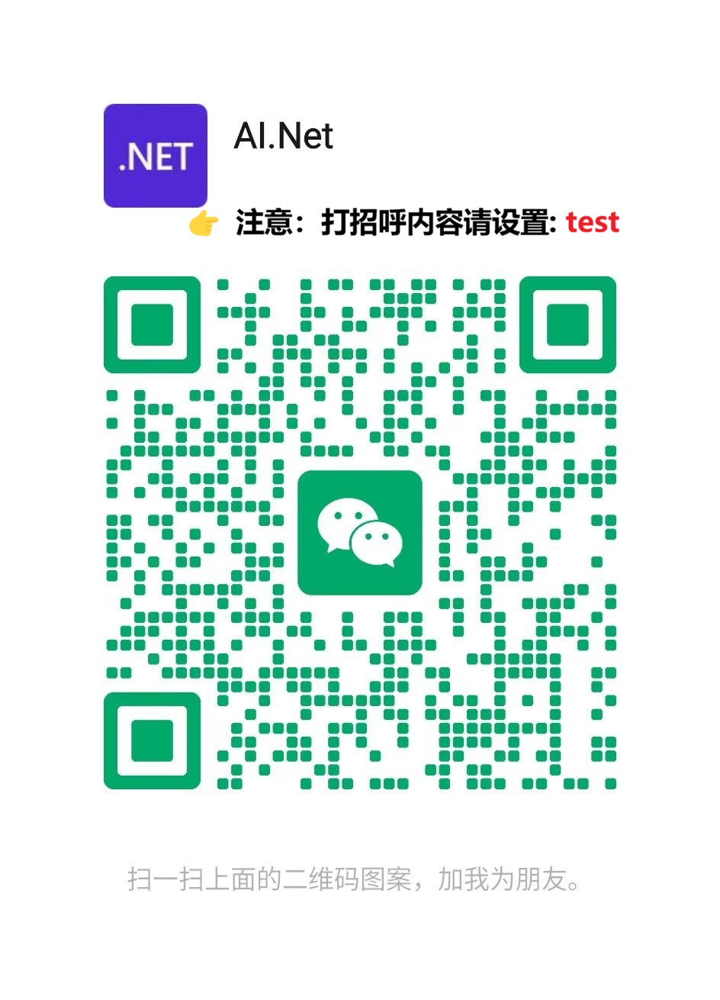

# WeChatAuto.SDK 体验说明


> 由于我将WeChatAuto.SDK的演示应用布署在一台老破旧的电脑上，并且人多的情况下设置了随机等候(0..10分钟)，所以请大家体验的时候耐心等候

> **打招呼内容请务必设置为：`test`**

## 体验方式

以添加好友的方式体验WeChatAuto.SDK的自动化能力，体验者请务必添加好友，添加方式请扫描下方二维码。

**添加好友：** 扫描下方二维码添加好友



## 体验程序的源码

体验程序基于 **WeChatAuto4x.SDK** 开发。当前体验包取消息以 Database Read 为主（只读、不 hook、不回写原库）；加好友、发消息、拉群等仍走 UIA。

下面这份示例脚本展示的是加好友、发消息、拉群等界面操作流程；取消息主路以当前体验包为准。

体验程序的源码如下：

```
using WeChatAuto.Services;
using WeChatAuto.Components;
using Microsoft.Extensions.DependencyInjection;
using System.Threading.Tasks;
using WeAutoCommon.Utils;
using System.Text.RegularExpressions;
using System.Runtime.InteropServices;

/*************************************************************
此demo为一个完整的自动化脚本，适用于自媒体自动接入好友
功能如下：
- 根据好友打招呼内容自动通过好友申请（这里是"test"）,并且自动设置好友后缀_test;
- 自动设置好友标签: test,并且自动获取好友的wxid等等信息，并且保存进cache文件中;
- 自动在通讯录列表删除好友申请记录，以保持“新增好友”列清洁;
- 主动跟新添加的好友打招呼;
- 发送文字信息;
- 发送图片信息;
- 发送emoji信息;
- 发送视频信息;
- 自动将新增好友拉入“人工智能自动化技术讨论群”;
- 在群中发送消息，并且@好友;
- 持续监听;

一个完整的流程
*/

var wxName = "AI.Net";   //你的微信名
var groupName = "人工智能自动化技术讨论群";   //拉入的群名

var serviceProvider = WeAutomation.Initialize(options =>
{
    options.EnableOCR = true;
    // options.DebugMode = false;
    // options.EnableMouseKeyboardSimulator = false;
    // //下面的内容可选，如果需要使用键鼠模拟器，请填写设备VID和PID，并启用键鼠模拟器，如果有校验数据，请填写校验数据
    // options.KMDevicePID = 0x1701;
    // options.KMDeviceVID = 0x2612;
});

using var clientFactory = serviceProvider.GetRequiredService<WeChatClientFactory>();
// 请修改为你的微信昵称
var client = clientFactory.GetWeChatClient(wxName);
// 注册拉好友监听
await client.AddFriendRequestAutoAcceptListener(new WeChatAuto.Options.FriendRequestAutoAcceptOptions
{
    KeyWord = new List<string> { "test", "wechatauto" },
    Suffix = "test",
    Label = "wechatauto",
    PassedDelete = true,
    PassedCallBack = async (whos, client, serviceProvider) =>
    {
        foreach (var item in whos)
        {
            if (item.FromKeyword.Equals("wechatauto"))
            {
                //处理好友通过打招呼"wechatauto"而来
                await client.SendMessage(item.Who, "Hi,你要咨询WeChatAuto.SDK的技术问题还是VIP相关问题哩？");
            }
            if (item.FromKeyword.Equals("test"))
            {
                //处理好友通过打招呼"test"而来
                await client.SendMessage(item.Who, "亲，终于盼到你了，我是基于微信4.1.9.55的wechatauto.sdk测试导航机器人，很高兴认识你！现在让我带你体验一下wechatauto.sdk的部分功能..大概1分钟时间..咱们开始咯....");
                await RandomWait.WaitAsync(2000, 2500);
                await client.SendMessage(item.Who, "~~嘘~~,别作声，我准备给你发图片消息 - 也是作者 Alex 的头像:");
                await RandomWait.WaitAsync(600, 2000);
                await client.SendFile(item.Who, new string[] { $"{AppContext.BaseDirectory}/Images/1.png" });
                await RandomWait.WaitAsync(1500, 3000);
                await client.SendMessage(item.Who, "我准备发送表情消息:");
                await client.SendEmoji(item.Who, 1);
                await RandomWait.WaitAsync(2000, 3000);
                await client.SendMessage(item.Who, "我准备发送视频...文件比较大，请稍候:");
                await client.SendFile(item.Who, new string[] { $"{AppContext.BaseDirectory}/Videos/1.mp4" });
                await RandomWait.WaitAsync(10000, 15000);
                await client.SendMessage(item.Who, "Now...我准备拉你到一个人工智能自动化技术讨论群（非VIP群），请稍候...");
                await RandomWait.WaitAsync(2000, 4000);
                await client.AddOwnerChatGroupMember("人工智能自动化技术讨论群", item.Who);
                await RandomWait.WaitAsync(2000, 4000);
                await client.SendMessage(item.Who, "👉 请加上面发给你的群....群里都是专注人工智能在自动化应用的高手.....");
                await RandomWait.WaitAsync(3000, 6000);
                await client.SendMessage(item.Who, "怎么样?....是不是很Cool?呵呵😊,WeChatAuto.SDK为UI Tree自动化+OCR视觉混合方案，并且天生为人工智能而生，下面我把我的源码发给你，给你看看优美的API设计，另外你接入LLM大模型后将更智能哦🎉🎉🚀🚀");
                await RandomWait.WaitAsync(1000, 3000);
                await client.SendFile(item.Who, new string[] { $"{AppContext.BaseDirectory}/Images/wechatauto_code.txt" });
                await RandomWait.WaitAsync(2000, 5000);
                await client.SendMessage(item.Who, "感谢你的体验，如果你有任何问题，可以随时联系作者，或者加入VIP群进行更深入的学习交流，祝你生活愉快,我做为测试导航机器人将暂时陪你到这，下次回复的会是人类😊。。。不过，如果是技术问题请在群里聊，因为这个微信号是挂我的，挂我的，挂我的...😊");
                await RandomWait.WaitAsync(1000, 2000);
                await client.SendMessage(item.Who, "~~再次祝愿你工作顺利，生活愉快，活到硅基崛起的时候~~");
            }
        }
    },
});
//注册系统监听-目的是发送好友入群欢迎信息，因为群人数多了，需要好友同意才能入群，所以只有监控好友入群时机.
await client.AddGroupSystemMessageListener(groupName, async context =>
{
    var who = context.FromWho;
    var sysMessageList = context.NewMessages;
    foreach (var message in sysMessageList)
    {
        if (message.Contains("邀请") && message.Contains("加入了群聊"))
        {
            var regex = new Regex("\"([^\"]+)\"(?=加入了群聊)");

            var match = regex.Match(message);
            if (match.Success)
            {
                var wxNames = match.Groups[1].Value.Split('、');
                foreach (var name in wxNames)
                {
                    await client.SendMessage(groupName, $"欢迎🎉🎉 {name} 🎉🎉来到本群- “ {name} ”老仙，德配天地，威震寰宇，古今无比！", "所有人");
                    await RandomWait.WaitAsync(1000, 3000);
                    await client.SendMessage(groupName,
        """

群规（请务必阅读）

- 本群为严谨的技术讨论群，核心主题为：
人工智能在自动化领域中的应用、实践与原理。
- 禁止讨论任何政治或涉政敏感话题。
该类内容与群定位无关，且无法产生建设性讨论。
- 禁止发布关于公司、人事、职场抱怨、情绪宣泄等内容。
本群不提供情绪价值，仅聚焦技术本身。
- 禁止分享个人生活相关内容，包括但不限于：
旅游、美食、日常琐事、个人动态等。

请将公共讨论资源留给技术话题，踩红线必T

欢迎内容：
 技术问题与实践经验
 架构设计、实现思路、踩坑总结
 对 AI + 自动化 的独立思考与专业见解

🎉 理性讨论，观点自由；聚焦技术，拒绝灌水。祝你在本群玩得开心😊
""", name);

                }
                RandomWait.Wait(800, 1200);
                await client.SendMessage(groupName, $"菜鸟,有新大佬来了，请以非常热情、夸张、有感染力的语气来欢迎他，要让新人感受到全群都在欢迎他，可以适当使用大量感叹号、表情符号、拟声词、庆祝语气;可以把新人描述成“贵宾”、“大神”、“重量级嘉宾”、“天降紫微星”等夸张称呼;内容要积极、友善、幽默。输出仅包含欢迎词正文，不要附加解释,另外，虽然我@了你，你无须回复，直接向新人按上面的要求打招呼", "菜鸟");
                RandomWait.Wait(1500, 4000);
            }
        }
    }
});


await Task.Delay(-1);

```
