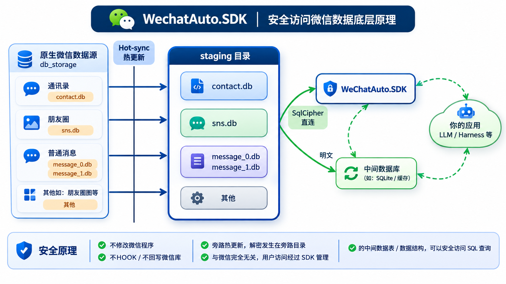

<div align="center">
<h1>WECHATAUTO.SDK - 安全构建微信Agent的开发基座</h1>
<p><strong>不注入、双路径、安全构建</strong></p>
<h4>微信是应用，WeChatAuto.SDK 是开发微信自动化应用的开发包</h4>
<p>这是一个面向开发者的微信自动化开发工具包，帮助你构建自己的微信机器人、微信助手和企业系统集成;</p>
<p>本仓库是社区开源版，用 UI Automation 操作真实微信，可先跑监听、发送、好友、群等基础能力,纯轻量SDK，不含多余的界面或成品应用;</p>
<p>
<a href="https://dotnet.microsoft.com/"></a>
<a href="https://www.python.org/"></a>
<a href="https://isocpp.org/"></a>
<a href="https://go.dev/"></a>
<a href="https://www.java.com/"></a>
<a href="https://nodejs.org/"></a>
<a href="https://www.rust-lang.org/"></a>
<a href="LICENSE"></a>
</p>
<p><strong><a href="https://scottfly189.github.io/WeChatAuto.SDK/">Website</a> · <a href="https://github.com/scottfly189/WeChatAuto.SDK/releases/download/2.0.7/community_allin.rar">一键试用</a> · <a href="https://scottfly189.github.io/WeChatAuto.SDK/main.html#/README">Guides</a> · <a href="#-faq">FAQ</a></strong></p>
<p><a href="./docs/why.md">为什么选择我们?</a></p>
</div>


<div align="center">
<br />


<br/>


<br/>
</div>

> [!TIP]
> **体验提示**：如果需要体验WeChatAuto.SDK的通力，我架设了一个测试导航机器人，欢迎**添加微信好友**体验，👉 [我要体验](./MD/Experience.md).

## 📋 系统要求

- Windows 操作系统,不支持Linux和MacOS;
- **风控风险**：频繁操作可能触发微信风控机制，建议：
   - 控制操作频率
   - 避免短时间内大量操作
   - 使用键鼠模拟器降低风险

## ✨ 快速入门

### 新人推荐（一键试用）

[community_allin.rar](https://github.com/scottfly189/WeChatAuto.SDK/releases/download/2.0.7/community_allin.rar) 是限时可用的 VIP 体验包，不是本仓库社区开源版的构建。解压运行即可先完整体验；日常开发请从本仓库源码或 NuGet 接入社区版。

1. 下载 [community_allin.rar](https://github.com/scottfly189/WeChatAuto.SDK/releases/download/2.0.7/community_allin.rar)
2. 解压
3. 打开并登录微信（Windows）
4. 运行解压目录里的 `Server.exe`
5. 用吸附条，或打开 http://localhost:5000/swagger ，发一条消息验收

HTTP WebAPI 方式不写代码即可接消息，说明见 [HTTP Server 使用](https://scottfly189.github.io/WeChatAuto.SDK/main.html#/httpserveruse)。

> [!NOTE]
> SDK支持两种使用方式: ```内嵌方式```(Embedded) 与 ```HTTP WebAPI``` 方式
> 
> 本质上`HTTP WebAPI`的方式为: WeChatAuto.SDK直接把微信消息帮你抓取，然后送到你指定的数据库，你的应用直接访问数据库即可！[接入指南](https://scottfly189.github.io/WeChatAuto.SDK/main.html#/README)

### 进阶：.NET 内嵌开发

已有 .NET 项目、需要把 SDK 嵌进自己的程序时，再看本节。

> [!IMPORTANT]
> 使用前请用Claude code 安装.net10环境;
>
> 此示例在Examples目录的[FirstDemo](https://github.com/scottfly189/WeChatAuto.SDK/tree/master/WeChatAuto4_X/Examples/FirstDemo)项目中;
> 
> 更多使用请参见: [使用指南](https://scottfly189.github.io/WeChatAuto.SDK/main.html#/README)

1. 新建一个.net10控制台项目

```csharp
dotnet new console -n demo
```

2. 修改项目属性，打开 demo.csproj 文件，把```TargetFramework```修改为```net10.0-windows```,如果你使用的是.net6.0或.net7.0，请把```TargetFramework```修改为```net6.0-windows```或```net7.0-windows```，如下所示:
```xml
<Project Sdk="Microsoft.NET.Sdk">

  <PropertyGroup>
    <OutputType>Exe</OutputType>
    <TargetFramework>net10.0-windows</TargetFramework>
    <ImplicitUsings>enable</ImplicitUsings>
    <Nullable>enable</Nullable>
  </PropertyGroup>

</Project>

```

3. 安装依赖包
  
```bash
dotnet add package Microsoft.Extensions.DependencyInjection
dotnet add package WeChatAuto4x.SDK
```

4. 在 Program.cs 中编写如下代码：

```csharp
using WeChatAuto.Services;
using WeChatAuto.Components;
using Microsoft.Extensions.DependencyInjection;

var serviceProvider = WeAutomation.Initialize(options =>
{
    options.DebugMode = false;   // 可选，在生产环境建议关闭
    options.IsForceOpenUITree = true; //是否强开微信的UI Tree,如果确认自己的微信UI Tree是开启的，则可以设置为False    
});

using var clientFactory = serviceProvider.GetRequiredService<WeChatClientFactory>();
//检查打开有几个微信
var wechat_list = clientFactory.GetWeChatClientNames();
Console.WriteLine($"电脑上打开微信{wechat_list.Count()}个: {string.Join(',',wechat_list)}");

// 打开第一个微信，发送消息
var client = clientFactory.GetWeChatClient(wechat_list.First());
// 给好友 AI.Net_test 发送文本消息,这里应该改成你自己的微信名称.
await client.SendMessage("AI.Net_test","hello world!!");

... 更多功能请参考文档
```

## 🥶 给 AI 生吞的接口文档

完整接口说明：[https://scottfly189.github.io/WeChatAuto.SDK/llms-full.txt](https://scottfly189.github.io/WeChatAuto.SDK/llms-full.txt);

短索引：[https://scottfly189.github.io/WeChatAuto.SDK/llms.txt](https://scottfly189.github.io/WeChatAuto.SDK/llms.txt)。

备用（raw）：[https://raw.githubusercontent.com/scottfly189/WeChatAuto.SDK/master/docs/llms-full.txt](https://raw.githubusercontent.com/scottfly189/WeChatAuto.SDK/master/docs/llms-full.txt)

[https://raw.githubusercontent.com/scottfly189/WeChatAuto.SDK/master/docs/llms.txt](https://raw.githubusercontent.com/scottfly189/WeChatAuto.SDK/master/docs/llms.txt)

> [!TIP]
> 请给你的 AI 先喂 llms-full.txt，或者直接把 `raw` 里的 llms-full.txt 的在线链接喂给 AI，之后向AI提问：这个 SDK 的能力有哪些？它的接口文档在哪里？它的使用示例有哪些？它的使用限制是什么？它的使用注意事项有哪些？它的使用风险是什么？它的使用场景有哪些？它的使用方式有哪些？它的使用方法有哪些？它的使用步骤有哪些？它的使用流程有哪些？它的使用技巧有哪些？它的使用经验有哪些？它的使用心得有哪些？它的使用建议有哪些？它的使用指南有哪些？...如此等等,目的是让 AI 熟悉接口;
>
> **AI熟悉接口后，你就可以让AI基于SDK的能力，帮你写出自动化微信的代码了;**

## 🚣 项目结构

```
src/                               # WeChatAuto.SDK 仓库根
├── WeAutoCommon/                  # 跨版本共用的基础库（无 UI 自动化入口，纯数据/工具）
│   ├── Configs/                   # 微信相关配置
│   ├── Enums/                     # 消息类型、会话类型、转发类型等枚举
│   ├── Exceptions/                # 自定义异常（如 WindowNotExsitException）
│   ├── Extentions/                # 扩展方法
│   ├── Interface/                 # IWeChatWindow 等接口契约
│   ├── Models/                    # 会话、好友、消息、朋友圈等通用模型
│   ├── Simulator/                 # 键鼠模拟器 Skm（含 x64/x86 原生库）
│   ├── Utils/                     # AutomationElement/IME/注册表/随机等待等工具
│   └── WeAutoCommon.csproj
│
├── WeChatAuto4_X/                 # 微信 4.x 当前版本 SDK（主仓库）
│   ├── WeChatAuto/                # SDK 核心项目
│   │   ├── Assets/                # UI 图标资源
│   │   ├── Components/            # WeChatClient/Factory、Sender、Search、Group、Moments、消息监控等
│   │   ├── Services/              # WeAutomation 初始化、OCR、Qwen、键鼠模拟器服务
│   │   ├── Models/                # 消息、气泡、好友、语音等模型
│   │   ├── Options/               # 各功能配置项
│   │   ├── Extentions/            # 自动化元素/点击增强/录屏等扩展
│   │   ├── Exceptions/            # 自定义异常
│   │   ├── Utils/                 # DPI/剪贴板/窗口/录屏/多开调度/LCS/DIFF BLOCK/CheckPoint等核心工具
│   │   ├── WeChatAuto.csproj
│   │   └── WeChatAuto.sln
│   │
│   ├── WeChatAuto.Tests/          # 微信 4.x 单元测试（Assets/Components/Utils）
│   │
│   ├── HttpSupport/               # HTTP WebAPI 方式
│   │   ├── Server/                # WinForms 服务端（可直接运行） 💎
│   │   │   ├── Forms/             # 主界面、发消息、转发、监控配置、定时任务等窗体
│   │   │   ├── Controls/          # 自定义卡片控件
│   │   │   ├── Services/          # 定时发送、Cron、日志
│   │   │   ├── Utils/             # SDK 版本探测等
│   │   │   ├── Assets/            # 图标、虚拟声卡驱动
│   │   │   ├── models/            # OCR 模型
│   │   │   ├── Docs/              # API 接入指南、发布教程
│   │   │   ├── App.json / Program.cs / Server.csproj / obfuscar.xml
│   │   │   └── README.md
│   │   └── Client/                # 各语言 HTTP 客户端 SDK
│   │       ├── .net/              # C# 客户端
│   │       ├── c++/               # C++ 客户端（CMake）
│   │       ├── go/                # Go 客户端
│   │       ├── java/              # Java 客户端（Maven）
│   │       ├── node/              # Node.js 客户端（npm）
│   │       ├── python/            # Python 客户端
│   │       └── rust/              # Rust 客户端（Cargo）
│   ├── skills/                    # WeChatAuto.SDK 技能（发送消息/发送语音/发朋友圈）
│   ├── Examples/                  # 示例项目
│   │   ├── FirstDemo/             # 30 秒快速上手示例
│   │   ├── AutoReceiveNewFriends/ # 自动通过加好友申请并聊天  💎
│   │   ├── QrcodeTransfer/        # 二维码转发（待完成中)  💎
│   │   ├── SystemMessageMonitor/  # 系统消息监控     💎
│   │   └── WinForm_Demo/          # WinForms 可视化 Demo
│   │   └── WinFormWithHttpWebAPI/ # Winforms调用HttpWebAPI客户端示例
│   │
│   ├── WeChatAuto4_X.sln
│   └── README.md
│
├── docs/                          # 文档站点（docsify + Swagger API）
│   ├── api-site/                  # Swagger UI + swagger.json
│   ├── images/                    # 文档截图
│   ├── _media/                    # logo/icon 素材
│   ├── ability.md / faq.md / why.md / webapi.md / mcpserver.md / httpserveruse.md / inlineuse.md
│   └── README.md / index.html / _coverpage.md / _navbar.md / sw.js
│
├── Resources/                     # 资源（VBCABLE 虚拟声卡驱动）
├── Tools/                         # 开发辅助工具
│   ├── UISpy.exe / inspect.exe    # UI Tree 查看工具
│   ├── FlaUInspect / AutomationSpy # UI 自动化检查器
│   ├── EnableRdpMinimize.bat      # 远程桌面最小化自动化脚本
│   └── models/                    # OCR 模型（PP-OCRv6）
|
├── LICENSE
└── README.md

```

## 🏇 对比传统方案

| 维度 | 注入 / Hook / 回写原库 | WeChatAuto.SDK |
|---|---|---|
| 原理 | 注入、消息钩子，或改写微信原库 | 社区版走 UI 自动化；VIP 取消息再补只读 Database Read（不 hook、不回写原库） |
| 稳定性 | 微信更新即失效 | 界面操作随 UI 结构适配；VIP 取消息主路不再靠在界面上逐条抓取 |
| 风控 | 特征明显、风险高 | 低特征，可选硬件级 |
| AI 集成 | 无 | 原生 TTS / 语音克隆 / LLM |
| 多微信账号 | 难 | 原生多实例工厂支持 |
| 语言接入 | 单一 | 任意开发语言 |
| 交付 | 脚本 | 工程化 SDK + 文档 + 示例 |

## 🎯 典型应用场景

1. **AI 客服 / 微信机器人**：监听消息 → 大模型回复/Harness执行 → 自动发送。
2. **AI 语音外呼 / 电话机器人**：TTS + 声音复刻 → 发语音消息。
3. **多账号矩阵运营**：一个进程管理 N 个微信。
4. **群运营自动化**：建群、拉人、群公告、欢迎语、好友申请自动通过打标签。
5. **集成应用**：把微信消息接入企业内部系统，或把企业内部消息推送到微信。
6. **跨语言二次开发**：通过 REST API 用 Python/Node 快速搭业务。
7. **更多应用场景待你开发中...**

## 🎈 关于键鼠模拟器

键鼠模拟器是一类专门的硬件设备，能够模拟物理键盘和鼠标的真实输入。相较于直接调用 PostMessage、SetInput 等 API 进行注入，这类传统软件方式往往会留下可被识别的痕迹，极易被微信等应用检测为自动化行为并引发风控。而键鼠模拟器通过硬件底层发送信号，模拟出的输入和人手操作无异，从而高度还原人类使用方式，在风控安全性和隐蔽性方面具备天然优势。

实际测试表明，在微信某些高敏感操作场景（比如群聊内加好友）下，借助键鼠模拟器能有效降低被风控的概率。需要注意的是，即便是手动操作，部分极端高风险情况下也有可能触发风控。因此，强烈建议在高敏感度和易风控场景优先考虑且规范使用键鼠模拟器，以获得更稳定和安全的自动化体验。

本 SDK 同时支持纯软件自动化以及结合硬件键鼠模拟器的自动化操作，满足不同业务需求和安全等级场景下的使用选择。

关于键鼠模拟器更深度的了解，请参见：[键鼠模拟器](https://github.com/scottfly189/SKSimulator)


## 🏌️‍♂️ 关于VIP

看完社区版之后，如需对照完整能力或了解 VIP，请直接看 [WECHATAUTO.SDK 能力表](./docs/ability.md)。

如需升级成为 VIP，或了解具体权益和支持方案，👉[请与我联系](https://github.com/scottfly189/scottfly189/blob/main/vip.md)。

## 🛡️ 为什么 Database Read 是安全的？

Database Read 是 VIP 能力，本仓库社区开源版不包含这部分代码。它不修改微信程序，也不回写微信原库：先把数据文件热更新到旁路 staging 目录，再用 SQLCipher 只读打开副本，明文只进入我们的中间库。你的应用通过 SDK 查询中间表，不直接访问微信原库。

<div align="center">

</div>

## 💬 社区

欢迎加入 Telegram，交流微信 Agent / SDK 使用与二次开发。

[加入 Telegram](https://t.me/wechatauto_sdk/1) · [@wechatauto_sdk](https://t.me/wechatauto_sdk)

<p align="center">
  
</p>

## 📝 许可证

本项目采用 MIT 许可证。详见 [LICENSE](LICENSE) 文件。

## 🔆 FAQ
<details>
<summary>❓ 运行WechatAuto.sdk的示例自动化不了微信客户端？</summary>
回答：请按下面的步骤检查：

- 确保待自动化的微信的窗口是打开状态;
- 检查windows版本，仅支持win10+;
- 若当前微信未暴露 UI Tree，请参考 [如果没有 UI Tree 怎么办](https://github.com/scottfly189/WeChatAuto.SDK/issues/3)
  > 查看UI Tree的方法：下载并安装 UI Tree查看工具，如: inspect.exe或者FlaUInspect等，[下载链接](https://github.com/scottfly189/WeChatAuto.SDK/tree/master/Tools)
- 如果经过上面的步骤还不行，请联系作者，并将你的代码发给他看;
</details>

<details>
<summary>❓ WechatAuto.sdk可以直接运行吗？</summary>
回答：SDK支持两种开发模式

- 内嵌方式，即以DLL或者Nuget包引入的方式，这个不能直接运行，因为是一个SDK开发包，需要整合在你的项目中使用，当然你也可以直接运行[示例代码](https://github.com/scottfly189/WeChatAuto.SDK/tree/master/WeChatAuto4_X/Examples/WinForm_Demo)或者单元测试;
- Http WebAPI的方式，这个可以直接运行，请[下载](https://github.com/scottfly189/WeChatAuto.SDK/releases/tag/2.0.7)后直接运行;
</details>

<details>
<summary>❓ 社区版和 VIP 是什么关系？</summary>
回答：本仓库是社区开源版，用 UI Automation 即可先跑监听、发送、好友、群等基础能力。VIP 为专用私库，提供更多能力与技术支持，完整对照见 [WECHATAUTO.SDK 能力表](./docs/ability.md)。请注意：一键试用包 [community_allin.rar](https://github.com/scottfly189/WeChatAuto.SDK/releases/download/2.0.7/community_allin.rar) 是限时可用的 VIP 体验包，不是社区开源版的构建。
</details>


<details>
<summary>❓ WeChatAuto.SDK开启录屏不成功？</summary>
问题：我使用了下面的代码开启了录屏后，运行被卡在在那里不往下运行了

```
WeAutomation.Initialize(builder.Services, options =>
{
    //开启调试模式，调试模式会在获得焦点时边框高亮，生产环境建议关闭
    options.DebugMode = true;
    //开启录制视频功能，录制的视频会保存在项目的运行目录下的Videos文件夹中
    options.EnableRecordVideo = true;  
});
```

回答：WechatAuto.SDK使用ffmpeg进行录制，如果系统没有安装ffmpeg，第一次运行会自动从官网下载ffmpeg.exe,此文件比较大，并且需要梯子，如果没有开梯子或者梯子质量不好，会产生上述情况，建议按下面的步骤解决：

1. 开VPN,等第一次下载完;
2. 手动上传ffmpeg.exe文件至项目运行的ffmepg目录下:
- 开发环境为：bin\Debug\net9.0-windows\ffmpeg\ffmpeg.exe
- 运行环境为: 你的执行文件所在目录\ffmpeg\ffmpeg.exe
</details>

<details>
<summary>❓ SDK安装在服务器运行，并且用远程桌面连接服务器，远程桌面最小化的时候自动化异常？</summary>
回答：请在"发起远程桌面的客户端电脑"上,而不是服务器上执行下面脚本:

1. [下载脚本](https://github.com/scottfly189/WeChatAuto.SDK/blob/master/Tools/EnableRdpMinimize.bat)
2. 下载脚本后按下面的步骤执行:
   - 执行作业之前，注销机器人（服务器）计算机上的所有用户。
   - 执行作业之后，重新打开远程桌面连接。
3. 现在，即使 RDP 窗口已最小化，您也可以自动化用户界面操作。
</details>

<details>
<summary>❓ 远程桌面连接服务器后SDK发送消息不了？</summary>
回答: 请远程桌面打开服务器的时候，远程桌面按下面步骤执行： 打开远程桌面->本地资源->剪切板 打上勾，让远程桌面支持剪切板;

如下图所示：


</details>

## 🤝 贡献

如果发现BUG或者有功能增强需求，欢迎提交 Issue 和 Pull Request！

## 🙏 致谢

在这里感谢那些还在为自由和正义而奋斗的人们🎉🎉

---


## ⚒️ 免责声明

本 SDK 仅供学习和研究使用，请遵守微信使用条款，不得用于任何违法违规用途。使用本 SDK 产生的任何后果由使用者自行承担。
