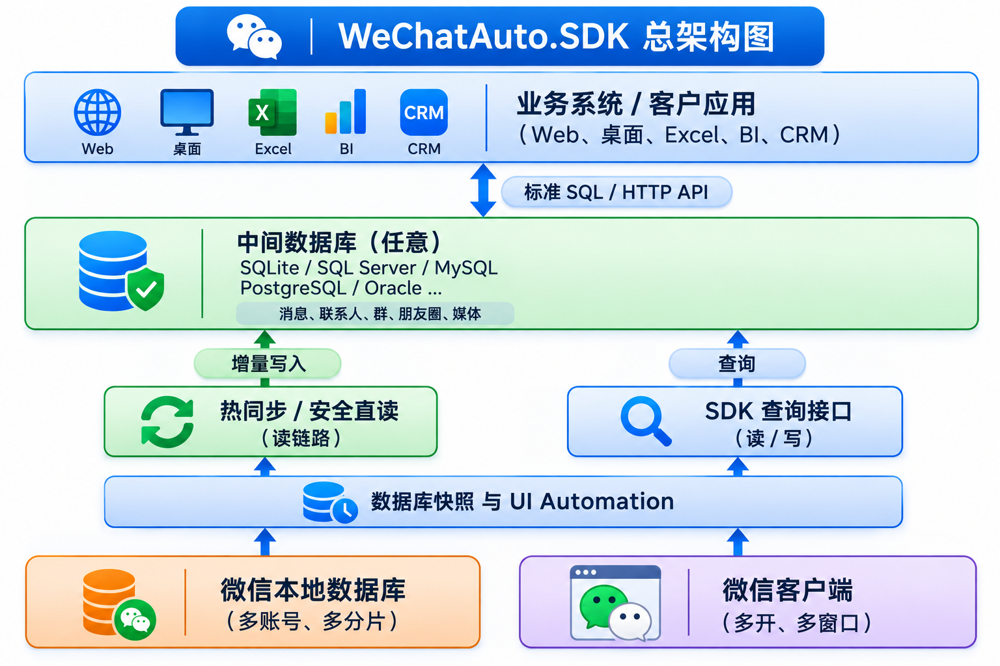

# 🔆 WECHATAUTO.SDK 简介

---

[](https://dotnet.microsoft.com/)
[](https://www.python.org/)
[](https://isocpp.org/)
[](https://go.dev/)
[](https://www.java.com/)
[](https://nodejs.org/)
[](https://www.rust-lang.org/)
[](LICENSE)

!> 微信是应用，WeChatAuto.SDK 是开发微信自动化应用的开发包。它面向开发者，帮助你构建自己的微信机器人、微信助手和 AI Agent；提供内嵌 SDK 与 HTTP WebAPI 两种开发方式，支持 .NET、Python、Java、Go、Node.js、Rust、C++ 等多种语言。

SDK 把微信能力拆成两条路径，而不是让所有事情都去点界面：

- **界面自动化（UI Automation）**：负责发送消息、加好友、建群、朋友圈互动等必须“操作微信界面”的动作；
- **数据库读取（Database Read）**：负责只读数据，支持把多个微信的消息、联系人、群成员、朋友圈持续同步到自己的中间库，也支持不建中间库、直接只读查询。

两条路径可以单独使用，也可以组合使用。社区开源版先提供界面自动化能力；数据库读取、热同步属于 VIP 能力，完整对照见 [WECHATAUTO.SDK 能力表](ability.md)。

# 🚀 开发模式选择

WeChatAuto.SDK 提供两种接入方式，核心能力是同一套，按你的技术栈和集成深度选择即可。社区开源版用界面自动化操作真实微信，可以先跑通监听、发送、好友、群等基础能力。

## 两种开发模式对比

| 对比项 | 内嵌方式 | HTTP WebAPI 方式 |
|---|---|---|
| 适合谁 | .NET / Windows 开发者，要把 SDK 嵌进自己的程序 | Python、Go、Java、Node、Rust、C++ 等非 .NET 开发者，或希望先不写代码就验收的人 |
| 典型场景 | 桌面助手、本机服务、需要事件回调和类型安全接口的深度集成 | 后端或云服务对接、多系统共用一个本机入口、跨语言、用 Swagger 快速联调 |
| 从哪里开始 | `WeAutomation.Initialize(...)` → `WeChatClientFactory` → `WeChatClient` | 启动 Server，使用 REST + Swagger，`http://<主机>:5000` |
| 特点 | 类型安全、能力最全、可深度定制；以 DLL / NuGet 形式进入自己的进程 | 语言无关、进程隔离、可远程；用界面配置即可开启消息监听、自动通过好友，不必先写代码 |

两者共享同一套核心能力（发送消息/文件/表情/语音、群操作、好友监听、朋友圈、导航等）。HTTP WebAPI 的每个接口注释里都标注了对应的 `WeChatClient.xxx`。

!> 绝大多数场景推荐先走 HTTP WebAPI；只有需要把包嵌进自己的 .NET 程序、并使用深度回调时，再选内嵌方式。

## 什么人适合 HTTP WebAPI?

适合下面这些情况：

- 你的主语言不是 .NET，想用官方的 Python、Java、Go、Node.js、Rust、C++ 客户端，或直接调用 REST；
- 你想先跑通：打开微信、启动 `Server.exe`，用吸附条或 Swagger 发一条消息验收，再接到自己的系统里；
- 已有后端或多个业务系统，希望共用本机这个微信入口，并和微信进程隔离开。

启动 Server 后访问 `http://<主机>:5000`。详细说明见 [HTTP WebAPI 开发方式指南](https://scottfly189.github.io/WeChatAuto.SDK/main.html#/httpserveruse)。

请注意：一键试用包 [community_allin.rar](https://github.com/scottfly189/WeChatAuto.SDK/releases/download/2.0.7/community_allin.rar) 是限时可用的 VIP 体验包，不是本仓库社区开源版的构建。日常开发请从本仓库源码或 NuGet 接入社区版。

## 什么人适合内嵌方式?

适合下面这些情况：

- 你在做 .NET / Windows 桌面或本机服务，要把 SDK 以 DLL 或 NuGet 包的形式嵌进自己的进程；
- 你需要事件回调、更低延迟、类型安全的完整接口，或要在自己的程序里深度定制。

入口是 `WeAutomation.Initialize(...)`，再通过 `WeChatClientFactory` 拿到 `WeChatClient`。详细说明见 [内嵌开发方式指南](https://scottfly189.github.io/WeChatAuto.SDK/main.html#/inlineuse)。

<a id="architecture"></a>

# 🏗️ 总体架构

<div align="center">

</div>

这张图把 SDK 分成三条线：

- **读链路**：微信本地数据库（多账号、多分片）→ 数据库快照 → 热同步 / 安全直读 → 增量写入中间数据库；
- **写链路**：业务系统 → SDK 查询接口 → 界面自动化 → 微信客户端（多开、多窗口）；
- **业务出口**：业务系统通过标准 SQL 或 HTTP API 访问中间数据库和 SDK 查询接口，不需要直接理解微信的原始数据库结构。Web、桌面程序、Excel、BI、CRM 都可以接。

读和写互不阻塞：读数据不经过界面，写操作不等待读任务。多个微信可以同时在线、同时被服务。

# 🛤️ 双路径：界面操作 + 数据库读取

本 SDK 的“双路径”不是二选一，而是三个维度同时可用。你可以按业务需要组合，不必被某一种方式绑死。

## 1. 读取方式：界面自动化与安全数据库读取

| 路径 | 负责什么 | 适合 |
|---|---|---|
| **界面自动化（UI Automation）** | 发送、监听、好友、群、窗口、导航等必须“操作微信界面”的动作 | 社区版即可；VIP 也继续使用 |
| **安全数据库读取（Safe Database Read）** | 只读微信数据库，查询联系人、消息、群成员、朋友圈，或持续同步到自己的数据库 | VIP；大库、多账号、数据型业务 |

两条路都不向微信进程注入第三方模块、不 Hook 消息、不写回微信原库。
界面自动化负责“操作微信”，数据库读取负责“读取数据”，二者并存而不是互相替代。

## 2. 数据库读取：热更新与直连两种用法

| 用法 | 做法 | 适合 |
|---|---|---|
| **数据库热更新（Hot Sync）** | 把多个微信账号的联系人、消息、群成员、朋友圈持续同步到自己的中间库，业务查中间库 | 大库、多账号聚合、消息持久化、长期业务查询 |
| **直连数据库（Direct Read）** | 不建中间库，直接只读查询微信数据库，按需取数 | 临时查询、工具/脚本、不想增加中间库的场景 |

两种用法共享同一套读取原则：不注入、不 Hook、不写回微信原库。
热更新适合“把微信变成业务数据源”；直连适合“只查一下、不落库”。

## 3. 接入方式：内嵌 SDK 与 HTTP WebAPI

| 接入方式 | 入口 | 适合 |
|---|---|---|
| **内嵌 SDK** | `WeAutomation.Initialize(...)` → `WeChatClientFactory` → `WeChatClient` | .NET / Windows 程序，需要事件回调、低延迟、类型安全 |
| **HTTP WebAPI** | 启动 Server，REST + Swagger | 跨语言、多系统共享、远程调用、快速联调 |

> **三个维度互相独立：** 你可以“界面自动化 + 数据库读取热更新 + HTTP WebAPI”，也可以“界面自动化 + 数据库读取直连 + 内嵌 SDK”。
> 社区版提供界面自动化；数据库读取、热更新/直连属于 VIP 能力。完整对照见 [WECHATAUTO.SDK 能力矩阵](ability.md)。

# 📥 读链路：热同步与安全直读

> 本节描述完整架构，方便你评估和规划。社区开源版只包含界面自动化；数据库读取与热同步属于 VIP 能力。

## 1. 数据从哪里来

- 微信本地数据库：消息分库、联系人、群、群成员、朋友圈、媒体索引；
- 首次运行自动发现账号目录和数据库位置，不需要客户手工找目录、填路径；
- 密钥首次获取后缓存，后续启动直接复用，不再重复获取。

## 2. 同步策略

- **增量优先**：每个账号维护自己的同步水位（最后同步时间或序号），只取新增和发生变化的数据；
- **变化检测**：对消息内容、媒体信息做哈希比对，内容没有变化就不重复写；
- **软删除**：微信侧删除的消息标记状态，不做物理删除，方便审计和追溯；
- **批量写入**：按批次写入中间表，减少数据库压力；
- **失败重试**：单批失败不影响其他账号，下一轮自动补齐。

## 3. 中间表

中间表按业务查询习惯设计，不直接把微信原始表暴露给业务：

- 消息表：会话、发送者、消息类型、内容、时间、媒体路径；
- 联系人表、群表、群成员表；
- 朋友圈表、朋友圈媒体表；
- 媒体表：图片、视频、语音、文件的本地路径与下载状态。

业务方只需要写标准 SQL，例如：

```sql
SELECT *
FROM wechat_message
WHERE ChatId = 'xxx'
  AND CreateTime > '2026-01-01'
ORDER BY CreateTime;
```

## 4. 为什么读数据不卡界面

- 不打开聊天窗口、不滚动、不模拟键盘鼠标；
- 不依赖 OCR 识别消息；
- 读取的是数据库快照，微信界面可以正常使用；
- 适合大批量历史数据、定时归档、实时增量。

# 📤 写链路：界面自动化

写操作包括：发送消息、通过 WxId 发送、加好友、建群、发朋友圈、朋友圈互动等。

## 1. 单 UI 线程模型

```text
业务调用（多线程、多账号）
        │
        ▼
  每个账号一个任务队列
        │
        ▼
  全局 UI 调度器（单线程）
        │
        ▼
  UI 专用线程
        │
        ▼
  微信窗口（界面自动化）
```

- 所有界面调用都在一个专用线程上执行，避免多个线程同时操作界面导致崩溃；
- 每个账号有独立队列，按账号串行执行；
- 全局信号量控制消息、好友、群监听，避免多个监听器争抢界面；
- 单个账号失败只影响该账号，不拖垮其他账号。

## 2. 为什么要单线程

界面自动化不是线程安全的：多个线程同时找控件、点按钮，容易出现“找不到元素”“点击错位”“窗口卡死”。单线程串行看起来慢一点，但稳定、可预测、不会互相踩，这是能上生产的关键。

## 3. 读和写怎么配合

- 读任务不占用 UI 线程，所以写操作不会被大量历史消息读取拖慢；
- 写操作执行时，读任务继续从数据库取数，互不影响；
- 发送消息后，通过数据库增量确认结果，不依赖界面“看起来发了”。

# 👥 多微信并行模型

| 资源 | 策略 |
|---|---|
| 数据库读取 | 按账号并行，互不阻塞 |
| 界面操作 | 全局单线程串行，按账号排队 |
| 消息监听 | 全局信号量串行，避免争抢 |
| 失败隔离 | 单账号失败不影响其他账号 |
| 背压保护 | 队列满时拒绝新任务，保护微信客户端 |

结论：**多个微信可以同时在线、同时被服务**；界面动作在底层串行调度，保证敏感操作不失败；读数据完全并行，不抢界面资源。

# 🧩 中间表与数据库

- 多微信的数据统一进一套中间表，用所属微信号区分来源；
- 支持 SQLite、SQL Server、MySQL、PostgreSQL 等标准数据库；
- 业务方直接连库、写 SQL，不需要理解微信原始表结构；
- 媒体文件保存在缓存目录，中间表只记录路径和下载状态，业务按需读取；
- 删掉中间库不会影响微信本身，重新同步即可恢复。

# ⚙️ 零配置与版本适配

## 零配置

- 自动发现微信安装目录、账号目录、数据库分片；
- 自动识别当前登录账号；
- 密钥缓存，后续启动不再重复获取；
- 媒体路径、缓存目录可配置，但有合理默认值。

## 版本适配

- 数据库结构变化：由同步层做字段映射和兼容，业务表结构保持不变；
- 界面变化：界面自动化常量集中在配置层，改版时只改少量常量；
- 功能开关：读链路、写链路、媒体下载、朋友圈同步都可以独立开关；
- 出问题时可降级：只读不写、只同步不下载、只服务单账号。

# 🚀 部署形态

- **SDK 形态**：NuGet 包，嵌入客户自己的 .NET 应用；
- **HTTP 服务形态**：自带 WebAPI，客户用任意语言调用；
- **数据库**：客户自己的库，SDK 只负责写入中间表；
- **运行环境**：Windows + 微信客户端；OCR 模型随程序分发；
- **多开**：支持多个微信实例，统一管理。

# ⚠️ 边界与风险

- **读**不依赖界面，但依赖微信本地数据可读；微信大版本升级时，同步层需要适配；
- **写**依赖微信客户端运行，界面改版会影响少量动作，需要更新界面自动化常量；
- **不承诺“完全无感”**：写操作仍然需要微信窗口存在，只是读数据不打扰用户；
- **合规**：数据只进客户自己的数据库，不上传云端；密钥只在本机缓存。具体合规要求由客户按自身行业判断。

# 📊 与行业其他两类解决方案的技术对比

| 维度 | 纯数据库方案(weflow\wechatauto-replica等) | 纯界面自动化方案(wxauto等) | 我们 |
|---|---|---|---|
| 读数据 | 快、全，但依赖密钥 | 慢、依赖界面 | 数据库快照，快且全 |
| 写操作 | 基本没有 | 有，但占界面 | 有，且读不影响写 |
| 多账号 | 各自维护 | 容易互相干扰 | 统一中间表 + 单 UI 线程调度 |
| 对界面影响 | 不占界面 | 抢键鼠、抢焦点 | 读零打扰，写可控 |
| 版本升级 | 密钥/结构变化影响大 | 界面变化影响部分动作 | 分层适配，影响面小 |
| 集成方式 | 客户自己解析微信表 | 客户自己写界面脚本 | 标准 SQL / HTTP API |
| 适用场景 | 历史导出、分析 | 轻量互动、单号 | 数据平台 + 互动 + 多号 |

# 📚 进一步了解

- [WECHATAUTO.SDK 能力表](ability.md)：社区版与 VIP 的能力差异；
- [HTTP WebAPI 开发方式](httpserveruse.md)：启动、配置、Swagger 联调；
- [内嵌开发方式](inlineuse.md)：`WeAutomation.Initialize(...)` 与 `WeChatClient`；
- [常见问题](faq.md)：部署、运行环境、常见报错。
