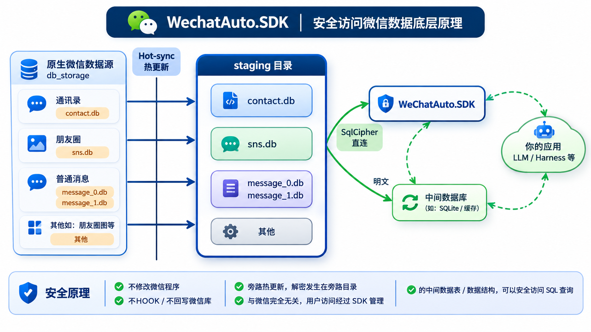

# 🔆 WECHATAUTO.SDK简介

---

!> 不注入、双路径、安全构建。微信是应用，WeChatAuto.SDK 是开发微信自动化应用的开发包。这是一个面向开发者的微信自动化开发工具包，帮助你构建自己的微信机器人、微信助手和 AI Agent。本仓库是社区开源版，用 UI Automation 操作真实微信，可先跑监听、发送、好友、群等基础能力。完整能力对照见 [WECHATAUTO.SDK 能力表](ability.md)。

# 🎉 核心特性

- 🔓 **纯 UI 自动化，不注入** — 基于 Windows 官方 UI Automation（FlaUI/UIA3）驱动微信，不往微信进程注入任何 DLL、不挂消息钩子。适合发送、好友、群等必须「点」微信的能力，社区开源版即可先走这条上手。
- 🎯 **全场景能力覆盖** — 消息收发（文字/@/引用/文件/表情/语音）、群管理（建群/改名/公告/成员增删/退群/邀请）、好友与通讯录、朋友圈、消息监听、消息转发，一套 SDK 搞定整个微信业务。
- 🤖 **AI 原生** — 内置阿里千问 **TTS 语音消息**、**LLM 文本口语化优化**、**声音复刻 / 语音克隆**（VIP），为 AI 客服、语音机器人等场景开箱即用。
- 👥 **多微信实例支持** — `WeChatClientFactory` 一个进程同时管理多个微信客户端，天然支持矩阵运营与多账号客服。
- 🌐 **HTTP REST API + Swagger** — 内置 ASP.NET Core 服务，把消息/好友/群/会话/导航全能力暴露为 REST 接口，任何语言都能接入。
- 🧩 **7 种语言官方客户端 SDK** — 提供 .NET / Python / Java / Go / Node.js / Rust / C++ 官方客户端，跨语言二次开发零门槛。
- 🔐 **API Key 鉴权 + 离线授权** — 内置 `X-API-Key` 鉴权与 RSA/DPAPI 离线许可证体系，方便做授权分发与商业化交付。
- ⚙️ **界面操作统一排队** — 需要走界面时，监听与发送在同一条 UI 操作队列里串行执行。
- 🧠 **内置 OCR** — 集成 PaddleOCR（PP-OCRv6 ONNX），无需额外部署即可应对图像识别场景。
- 🖥️ **远程桌面 / 生产环境适配** — RDP 会话转移、分辨率恢复、随机延时、异常截图、视频录制调试，拿来即可上生产。
- 🔌 **可选硬件级键鼠模拟器** — 配套 USB HID 硬件（SKSimulator），在硬件层注入键鼠信号，输入等同真人，显著降低风控误判。
- 📋 **完整能力对照** — 看过社区版之后，可用 [WECHATAUTO.SDK 能力表](ability.md) 了解 VIP 增加的能力与支持。请注意：一键试用包 `community_allin.rar` 是限时可用的 VIP 体验包，不是社区开源版的构建。

# 🚀 开发模式选择

WeChatAuto.SDK 提供两种接入方式，核心能力是同一套，按你的技术栈和集成深度选择即可。社区开源版用 UI Automation 操作真实微信，可先跑监听、发送、好友、群等基础能力。

## 两种开发模式对比

| | 内嵌方式 | HTTP WebAPI 方式 |
|---|---|---|
| 适用人群 | .NET / Windows 开发者，要把 SDK 嵌进自己的程序 | Python、Go、Java、Node、Rust、C++ 等非 .NET 开发者，或希望先不写代码就验收的人 |
| 典型场景 | 桌面助手、本机服务、需要事件回调和类型安全 API 的深度集成 | 后端或云服务对接、多系统共用一个本机入口、跨语言、用 Swagger 快速联调 |
| 入口 | `WeAutomation.Initialize(...)` → `WeChatClientFactory` → `WeChatClient` | 启动 Server，REST + Swagger，`http://<主机>:5000` |
| 特点 | 类型安全、能力最全、可深度定制；以 DLL / NuGet 形式进入自己的进程 | 语言无关、进程隔离、可远程；用界面配置即可开启消息监听、自动通过好友，不必先写代码 |

两者共享同一套核心能力（发送消息/文件/表情/语音、群操作、好友监听、朋友圈、导航等）。HTTP WebAPI 的每个接口注释里都标注了对应的 `WeChatClient.xxx`。

!> 绝大多数场景推荐先走 HTTP WebAPI；只有需要把包嵌进自己的 .NET 程序、并使用深度回调时，再选内嵌方式。

## 什么人适合 HTTP WebAPI

适合下面这些情况：

- 你的主语言不是 .NET，想用官方的 Python、Java、Go、Node.js、Rust、C++ 客户端，或直接调用 REST。
- 你想先跑通：打开微信、启动 `Server.exe`，用吸附条或 Swagger 发一条消息验收，再接到自己的系统里。
- 已有后端或多个业务系统，希望共用本机这个微信入口，并和微信进程隔离开。

启动 Server 后访问 `http://<主机>:5000`。详细说明见 [HTTP WebAPI 开发方式指南](https://scottfly189.github.io/WeChatAuto.SDK/main.html#/httpserveruse)。

请注意：一键试用包 [community_allin.rar](https://github.com/scottfly189/WeChatAuto.SDK/releases/download/2.0.7/community_allin.rar) 是限时可用的 VIP 体验包，不是本仓库社区开源版的构建。日常开发请从本仓库源码或 NuGet 接入社区版。

## 什么人适合内嵌方式

适合下面这些情况：

- 你在做 .NET / Windows 桌面或本机服务，要把 SDK 以 DLL 或 NuGet 包的形式嵌进自己的进程。
- 你需要事件回调、更低延迟、类型安全的完整 API，或要在自己的程序里深度定制。

入口是 `WeAutomation.Initialize(...)`，再通过 `WeChatClientFactory` 拿到 `WeChatClient`。详细说明见 [内嵌开发方式指南](https://scottfly189.github.io/WeChatAuto.SDK/main.html#/inlineuse)。

# 🔐 原理说明:为什么我们的 Database Read 是安全的？

Database Read 是 VIP 能力，本仓库社区开源版不包含这部分代码。完整对照见 [WECHATAUTO.SDK 能力表](ability.md)。

它要解决的核心问题是：怎样在微信正在运行时读取通讯录、消息、朋友圈等数据，同时不修改微信程序、不注入、不 Hook、也不回写微信原库。

👉 下面按我们实际开发过程中碰到的问题说明这条路径为什么是安全的。

## 不直接打开微信正在写的原库

微信运行时，库文件仍在被写入，还有 WAL 日志。如果直接打开工作目录里的原文件，既可能读到不一致的数据，也可能和微信抢同一个文件，影响微信自己的运行。

做法是：按目标库做一致性短时拷贝（库文件连同必要的日志）到旁路 staging 目录，然后我们只读打开这份副本。微信继续写自己的文件，读发生在旁路，两边不共用同一份正在写的文件。这就是图里的 Hot-sync 与 staging。

## 不注入、不 Hook、不回写原库

取数据不必改微信程序，也不往微信进程里注入或挂钩子。副本只读，中间库和缓存都在我们自己的目录里，不会把解密结果或同步结果写回微信原库。微信原库始终由微信自己维护。

## 明文和媒体不落回微信目录

我们 在 staging 副本上解开数据库后，把微信数据以明文的形式进入我们的中间库（例如你自己准备的 SQLite、PostgreSQL 等,你可以自行选择任何你熟悉的数据库）;

图片等需要解密的媒体，自行保存在我们的缓存目录，而不是写进微信的数据目录。你的应用和 LLM 只通过 SDK 查询中间表/Http WebAPI调用，不直接访问微信原库。即使删掉中间库，也不影响微信本身。

## 业务代码不直接面对原生库

微信侧是多账号、多分片的原生结构，不适合作为业务或 Agent 的直接数据源。中间表把这些复杂度挡住，访问经过 SDK 管理。这样既避免业务代码误碰原库，也让你用熟悉的 SQL 查询联系人、消息等数据。

## 支持多微信数据聚合

一台电脑上常常会同时登录多个微信。每个号在微信侧都是各自的目录和分库，如果业务或 Agent 分别去打开，既麻烦，也容易碰到原生结构。

Database Read 会把多个微信的通讯录、消息、群成员、朋友圈等，同步进你自己准备的同一套中间表，并用所属微信号区分来源。各账号的同步互不影响。你的应用只要查这一个中间库，或走 HTTP WebAPI，就能按账号、会话或时间查询，不必自己处理每个微信目录里的分库。
