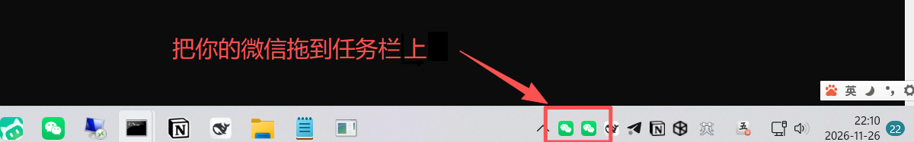

# FAQ

## ❓ 运行WechatAuto.sdk的示例自动化不了微信客户端？
回答：请按下面的步骤检查：

- 确保待自动化的微信的窗口是打开状态;
- 检查windows版本，仅支持win10+;
- 若当前微信未暴露 UI Tree，请参考 [如果没有 UI Tree 怎么办](https://github.com/scottfly189/WeChatAuto.SDK/issues/3)
  > 查看UI Tree的方法：下载并安装 UI Tree查看工具，如: inspect.exe或者FlaUInspect等，[下载链接](https://github.com/scottfly189/WeChatAuto.SDK/tree/master/Tools)
- 如果经过上面的步骤还不行，请联系作者，并将你的代码发给他看;

## ❓ 发送消息失败？

回答： 部分API需要将微信拖动到任务栏右边,如下图所示:



## ❓ WechatAuto.sdk可以直接运行吗？
回答：SDK支持两种开发模式

- 内嵌方式，即以DLL或者Nuget包引入的方式，这个不能直接运行，因为是一个SDK开发包，需要整合在你的项目中使用，当然你也可以直接运行[示例代码](https://github.com/scottfly189/WeChatAuto.SDK/tree/master/WeChatAuto4_X/Examples/WinForm_Demo)或者单元测试;
- Http WebAPI的方式，这个可以直接运行，请[下载](https://github.com/scottfly189/WeChatAuto.SDK/releases/tag/2.0.7)后直接运行;

## ❓我运行的时候提示:```Unhandled exception. System.Exception: 错误：Det模型文件不存在！```怎么办？

回答：请检查你的项目运行目录下是否有Det模型文件，如果没有，请下载OCR模型文件，步骤如下：

1. ```git clone https://github.com/scottfly189/WeChatAuto.SDK``` 或者 直接在[这里](https://github.com/scottfly189/WeChatAuto.SDK/tree/master/Tools)拷贝```models```文件夹到你的项目运行目录下;
2. 把```models```文件夹拷贝到你的项目运行目录下，注意：如果你是使用vs运行的，请把```models```文件夹拷贝到```bin\Debug\netx.x-windows```目录下;
3. 再运行你的项目，就不会报错了;

## ❓ 社区版和 VIP 是什么关系？
回答：本仓库是社区开源版，用 UI Automation 即可先跑监听、发送、好友、群等基础能力。VIP 为专用私库，提供更多能力与技术支持，完整对照见 [WECHATAUTO.SDK 能力表](./ability.md)。请注意：一键试用包 [community_allin.rar](https://github.com/scottfly189/WeChatAuto.SDK/releases/download/2.0.7/community_allin.rar) 是限时可用的 VIP 体验包，不是社区开源版的构建。

## ❓ WeChatAuto.SDK开启录屏不成功？
问题：我使用了下面的代码开启了录屏后，运行被卡在在那里不往下运行了

```
WeAutomation.Initialize(builder.Services, options =>
{
    //开启调试模式，调试模式会在获得焦点时边框高亮，生产环境建议关闭
    options.DebugMode = true;
    //开启录制视频功能，录制的视频会保存在项目的运行目录下的Videos文件夹中
    options.EnableRecordVideo = true;  
});
```

回答：WechatAuto.SDK使用ffmpeg进行录制，如果系统没有安装ffmpeg，第一次运行会自动从官网下载ffmpeg.exe,此文件比较大，并且需要梯子，如果没有开梯子或者梯子质量不好，会产生上述情况，建议按下面的步骤解决：

1. 开VPN,等第一次下载完;
2. 手动上传ffmpeg.exe文件至项目运行的ffmepg目录下:
- 开发环境为：bin\Debug\net9.0-windows\ffmpeg\ffmpeg.exe
- 运行环境为: 你的执行文件所在目录\ffmpeg\ffmpeg.exe

## ❓ SDK安装在服务器运行，并且用远程桌面连接服务器，远程桌面最小化的时候自动化异常？
回答: 请在"发起远程桌面的客户端电脑"上,而不是服务器上执行下面脚本:

1. [下载脚本](https://github.com/scottfly189/WeChatAuto.SDK/blob/master/Tools/EnableRdpMinimize.bat)
2. 下载脚本后按下面的步骤执行:
   - 执行作业之前，注销机器人（服务器）计算机上的所有用户。
   - 执行作业之后，重新打开远程桌面连接。
3. 现在，即使 RDP 窗口已最小化，您也可以自动化用户界面操作。

## ❓ 远程桌面连接服务器后SDK发送消息不了？
回答: 请远程桌面打开服务器的时候，远程桌面按下面步骤执行： 打开远程桌面->本地资源->剪切板 打上勾，让远程桌面支持剪切板;

如下图所示：


## ❓ 怎么给 AI 用

- 把 [https://scottfly189.github.io/WeChatAuto.SDK/llms-full.txt](https://scottfly189.github.io/WeChatAuto.SDK/llms-full.txt);

- 备用（社区 raw）：[https://raw.githubusercontent.com/scottfly189/WeChatAuto.SDK/master/docs/llms-full.txt](https://raw.githubusercontent.com/scottfly189/WeChatAuto.SDK/master/docs/llms-full.txt);