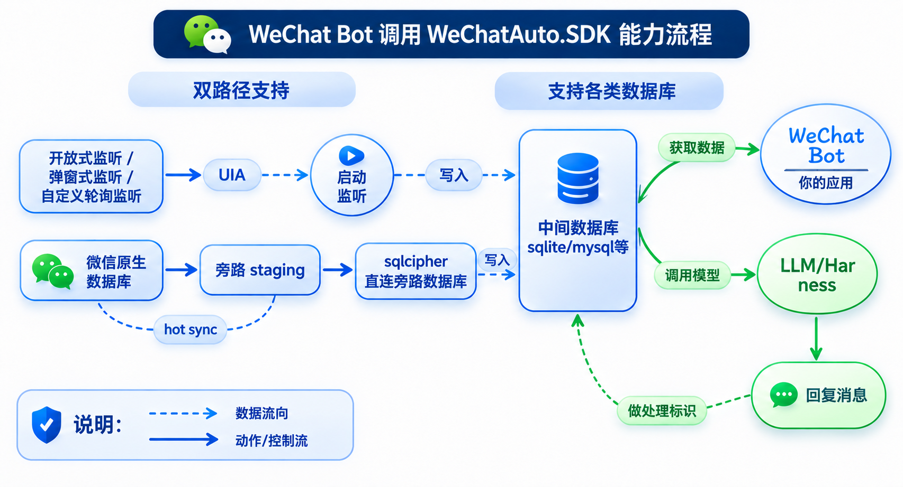
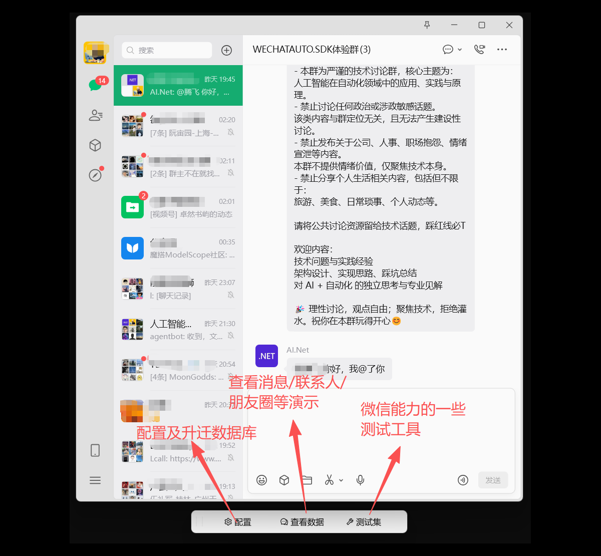
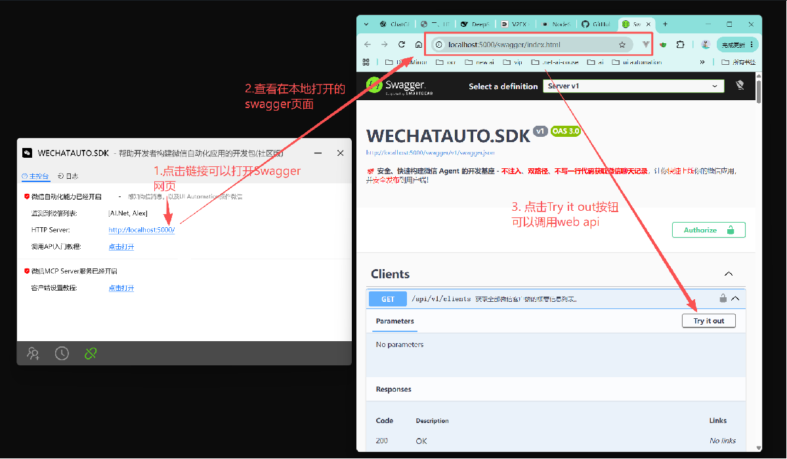
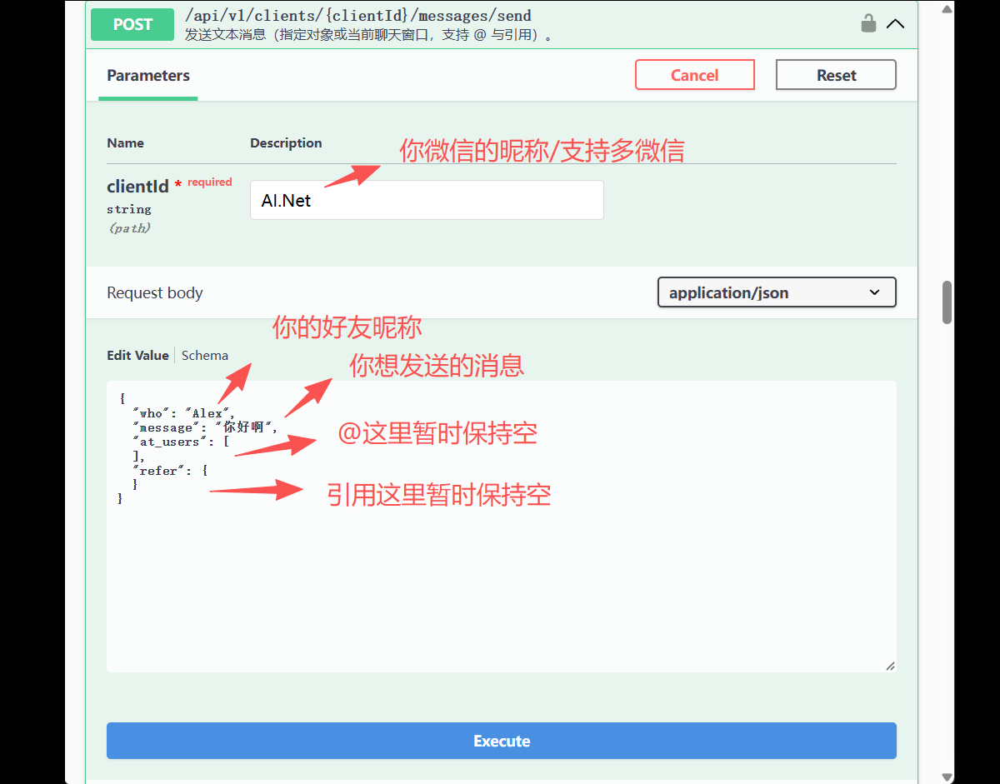
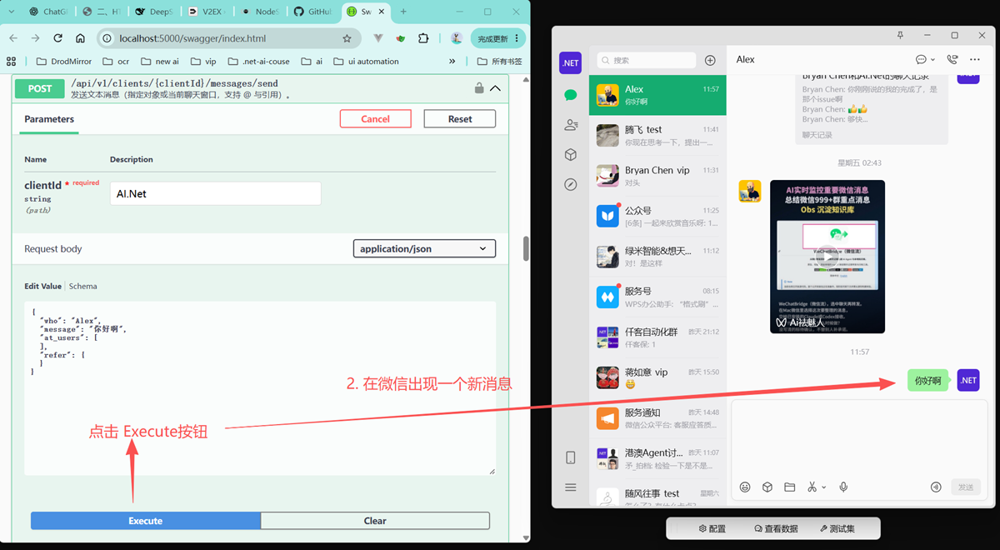

> 给 AI 用：先阅读 [https://scottfly189.github.io/WeChatAuto.SDK/llms-full.txt](https://scottfly189.github.io/WeChatAuto.SDK/llms-full.txt)（[短索引](https://scottfly189.github.io/WeChatAuto.SDK/llms.txt)；[社区 raw 备用](https://raw.githubusercontent.com/scottfly189/WeChatAuto.SDK/master/docs/llms-full.txt)）。社区版不要调仅 VIP 接口。

!> 如果你不是 .NET、不想管理 SDK 生命周期，或需要跨语言/远程调用,请使用 [HTTP WebAPI 方式](https://scottfly189.github.io/WeChatAuto.SDK/main.html#/httpserveruse)，<strong>`不需要书写一行代码获取微信消息`</strong>，官方推荐!

# 一、HTTP WebAPI介绍

## 1. 适用场景
- 你的业务是后端服务 / 云服务 / 跨语言系统，需要从 Python、Go、Java、Node.js、Rust 等调用微信能力
- 需要多个业务系统共享同一个微信自动化实例，支持远程调用（局域网或云服务器），例如客服系统、运营系统、RPA、低代码平台、第三方系统对接。
- 团队/业务方不想碰 .NET，只想用 HTTP 快速集成。
- 需要开箱即用的 GUI 管理界面、Swagger 在线文档与调试、定时发送、好友自动通过等现成功能。
- 希望业务与自动化解耦：自动化作为独立服务运维，业务代码只依赖稳定的 HTTP 契约。


## 2. 优点
- 语言无关：任何能发 HTTP、解析 JSON 的语言都能用，无需依赖 .NET;
- 进程隔离：自动化跑在独立 Server 进程里，业务系统崩溃不影响微信自动化；SDK 升级只需替换 Server;
- 可远程 / 多端共享：监听所有网卡（0.0.0.0），本机、局域网、云服务器都能访问;
- 开箱即用：自带 GUI 管理界面、Swagger 文档（可在线试调）、定时任务、好友自动通过等成品功能;
- 标准化契约：REST + snake_case JSON + 错误码（RFC 7807），可用 openapi-generator / Kiota / openapi-python-client / progenitor 自动生成各语言客户端;
- 有鉴权：X-API-Key 请求头鉴权，配合 Nginx/Caddy 反向代理加 HTTPS 可安全上公网;
- 获取好友/群的消息、自动接入好友申请等操作不需要写一行代码，只要通过设置就可以实现，极大的降低集成工作量;

## 3. HTTP WebAPI接入原理

!> `WeChatAuto.SDK` 的 HTTP 服务启动后，即可获取微信消息，也可自动通过加好友申请。



**一般开发微信能力集成在自己应用中的开发者有两个诉求:**

- 希望很方便的获取微信的好友/群的微信消息;
- 调用微信的能力，如：发送消息，转发消息，群管理等;

🏌️‍♂️ **WeChatAuto.SDK HTTP WebAPI 的使用方式如下:**

1. 启动 `HTTP服务` 后，通讯录、消息、群成员、朋友圈等会写入你配置的数据库。开发者直接查询数据库，就可以获取好友/群的消息，`无须开发任何一行代码`;
2. `HTTP服务` 只要正确开启，就会提供 `HTTP WebAPI` 服务。任何开发语言都可以通过发送 `Http` 请求调用微信的能力：如发送消息、进行群管理等;
3. 简言之：现在是 WeChatAuto.SDK 把微信数据送到你指定的数据库，你的 Bot 应用直接访问数据库即可；需要操作微信时，再调用 WebAPI。

多号默认写入同一套数据库，并用所属微信号区分来源。默认是本地 SQLite，也可以改成 MySQL 等你自己准备的库。

👉 如需查看全部数据表的字段和关系，请看 [数据库 Schema](schema.md)。

## 4. 使用步骤

!> **注意**： HTTP服务需要先下载！ 👉 [下载](https://github.com/scottfly189/WeChatAuto.SDK/releases/download/2.0.7/community_allin.rar)

请注意：这个一键试用包 [community_allin.rar](https://github.com/scottfly189/WeChatAuto.SDK/releases/download/2.0.7/community_allin.rar) 是限时可用的 VIP 体验包，不是本仓库社区开源版的构建。日常开发请从本仓库源码或 NuGet 接入社区版。


#### 🚀请按下面的步骤使用:
- 请先下载[HTTP服务端](https://github.com/scottfly189/WeChatAuto.SDK/releases/download/2.0.7/community_allin.rar),放置在本机/服务器的某个目录，然后解压缩;
- HTTP服务要与需要自动化的微信放在同一台电脑上;
- 先打开微信，并登入自己账号，保持微信窗口为打开状态(非关闭状态),支持多微信; 
- 最后打开HTTP服务(运行解压缩目录的Server.exe);
- 双击或者右键屏幕右下角的HTTP服务，在弹出的控制台窗口中点击链接打开Swagger页面,在弹出的Swagger页面可以在线调试API;
- HTTP服务请参考:[HTTP服务使用指南](#http服务使用指南);
- HTTP WebAPI参考请参考:[HTTP WebAPI 接入指南](#http-webapi-接入指南);
- 其他问题请参见[FAQ](https://github.com/scottfly189/WeChatAuto.SDK/blob/master/docs/faq.md);
- 有什么问题或者功能增强要求，请提[Issues](https://github.com/scottfly189/WeChatAuto.SDK/issues);

!> 也可以浏览[在线Swagger](https://scottfly189.github.io/WeChatAuto.SDK/api-site/index.html),但请不要操作，因为服务器没有打开对应的微信,具体还是以你本地打开的HTTP WebAPI服务为准！

# 二、HTTP服务使用指南
!> 后面的WebAPI调用依赖打开`HTTP服务`, 请使用者在使用前阅读本 `HTTP服务使用指南`,重要！

!> 前置条件: 请将你的微信拖动到桌面的右下角任务栏，如下图所示:


**1. 请先下载[HTTP服务端](https://github.com/scottfly189/WeChatAuto.SDK/releases/download/2.0.7/community_allin.rar),放置在本机/服务器的某个目录，然后解压缩;**
**2. 在解压缩的目录中打开 `Server.exe` 应用，如下图所示:**


双击`Server.exe`就可以运行本服务端

**3. 运行后，如果成功运行，会在右下角产生一个notifyicon图标，双击这个图标，可以看到主控台，如下图所示:**


!> 这里是HTTP WebAPI的主控台，如果看到以上的界面，证明Http Server正常工作中！

- 点击`HTTP Server`右边的链接，可以打开SWagger页面，可以在弹出的Swagger页面查看API定义及进行在线测试;
- 下面的`功能显示区`会显示自动通过好友、定时发送等功能的状态;
- 如果运行失败，也会显示在主控台，你可以点击 `日志` 选项卡查看为什么失败;

**4. 在主控台点击 `日志` 选项卡，展示运行日志**

- 在日志显示区可以查看日志;
- 点击右边的 `复制` 按钮，可以把日志全部复制到剪切板，你可以把日志复制到外部保存;
- 点击右边的 `清除日志` 按钮，可以清除日志，方便调试;
- 日志不会自动刷新，请点击右边的 `刷新` 按钮刷新最新日志;


**5. 在每个窗口的底部，会产生一个吸附窗口,会随着窗口移动而移动，如下图所示:**



!> 吸附窗口与每个微信相关，当某微信获得焦点时会显示，失去焦点时会消失，把鼠标移到每个按钮上面会显示每个按钮的 `tooltips`;

- `查看数据`：打开数据查看窗口，可查看消息、群成员、朋友圈和联系人;
- `配置`：设置消息写入的数据库。所有微信号共用同一个数据库，多号数据会自动聚合，并用所属微信号区分;
- `测试集`：发送消息、定时发送、设置演示、自动接入好友等现成功能。

启动服务并登录微信后，数据会写入你配置的数据库，不必再选择监听方式，也不必在微信窗口里点开会话来抓取消息。

**6. 点击吸附窗口的 `配置` 按钮，打开数据库配置界面，如下图所示:**


!> 中间库是全局唯一连接，所有微信号共用同一个数据库。默认是本地 `sqlite`，你可以改成自己的数据库，如 `mysql` 等。

- 在数据库类型列表选择所需要的数据库类型;
- 在连接字符串填写上面选择的数据库类型正确的连接字符串;
- 点击 `测试连接` 可以测试数据库的连通性;
- 点击 `保存配置` 后，需要重启应用才会切换到新库；重启时会先把旧库数据迁移到新库。

**7. 点击吸附窗口的 `查看数据`，如下图所示:**


- 窗口里有 `消息查看`、`群管理`、`朋友圈`、`联系人` 四个页签;
- 在 `消息查看` 中选择 `好友/群`，可以查看对应会话的消息记录;
- 也可以点击右边的 `刷新`、`导出` 按钮，查看或导出数据;
- 这里有一个技巧: 如果你点击的的会话是可聊天对象（好友/企业微信/群），你打开 `消息查看` 窗口，会自动读取该聊天窗口的好友/群的标题，然后自动定位到该会话的消息记录，方便查看。

**8. 核心操作: 通过Swagger测试一条消息发送**
- 首先点击电脑桌面任务栏右下角的 `notifyicon` 图标，打开主控台(有时候会被任务栏隐藏，点击右下角的 `^` 展开图标列表就可以看到);



1. 点击 `HTTP Server` 右边的链接，打开Swagger页面;
2. 在Swagger页面中，点击 `Clients` → `GET /api/v1/clients`，点击 `Try it out` 按钮，然后点击 `Execute` 按钮，就可以获取到当前运行的微信客户端列表;
3. 我们继续，我们找到发送文本消息的接口，点击 `Messages` → `POST /api/v1/clients/{clientId}/messages/send`，点击 `Try it out` 按钮



进行下面的操作：

在 `clientId` 中输入你的微信客户端昵称(如: `AI.Net` 注意：是你的微信客户端昵称，点击你的微信头像可以得到)，在 `Request body` 中输入如下内容:

```json
{
  "who": "你的好友昵称",
  "message": "你好啊",
  "at_users": [],
  "refer":{}
}
```

注：为了顺利完成测试，@好友与引用消息的参数可以不填，at_users和refer可以为空数组或空对象。

设置完毕后，点击 `Execute` 按钮，就可以自动发送一条文本消息给指定的好友了，参见下图:



- 同样原理，你可以测试发送文件、发送表情、发送语音消息等功能，具体请参见Swagger页面的API定义。
- 你过关了！你既然知道在Swagger页面发送消息，也就知道在ApiFox中发送消息，或者你直接可以在Python、Go、Java、Node.js、Rust等语言中发送消息了;

<details>
<summary>扩展学习：测试集</summary>

**这里说明一下**： 本SDK是一个开发微信自动化应用的SDK，并不是一个单独应用，提供测试集的目的是为了方便开发者快速了解SDK的功能，测试集的功能不代表SDK的全部功能，SDK的全部功能请参见Swagger页面的API定义。

1. 发送消息: 可以测试发送消息，也可以保存昵称集合，方便下次发送消息的时候可以快捷选择;

2. 定时发送: 可以设定定时任务，给多人发送一条或者多条消息;

3. 设置演示: 我觉得吸附窗口的设计是比较完美的设计，而做Wechat bot的时候，有很多需要对单个好友/群进行单独的设置，所以我在测试集里提供了一个如何对单个微信的单个好友/群进行单独设置的演示，操作方法如下： 首先你要在微信窗口选择一个好友/群，然后过两秒后，设置窗口会自动刷新，你可以设置一些选项，然后点击其他的好友/群，过两秒后，设置窗口会自动刷新，然后你可以返回到之前设置过的好友/群，设置窗口会自动刷新，显示你之前的设置，这样就可以对每个好友/群进行单独的设置了;因为本SDK支持 多微信，而吸附窗口是每个微信独立的，所以你可以把全局设置（多微信共享）放在`Notification`的右键菜单里，你难道不觉得这样的设计方式即Cool又简单实用？

4. 自动接入好友申请: 通过设定，有好友申请加你好友时，会自动通过，并可以根据每个关键词设定单独的标签与备注后缀;

!> 注： 测试集的一些设定会反馈在`控制台`的功能区中;

</details>

<br/>

# 三、HTTP WebAPI 接入指南

> 本服务是标准 HTTP RESTful 接口：任何能发 HTTP 请求、解析 JSON 的语言（.NET / Python / Rust / Go / Java / Node.js 等）都能直接调用，**无需依赖 .NET**。
>
> 每个接口的完整参数与返回结构，以运行中的 **Swagger UI** 为准：启动服务后访问 `http://<主机>:<端口>/swagger`。本文只讲「概念 + 约定 + 快速上手」——这些是 Swagger 页面本身不会教你的。

---

## 1. 配置文件（App.json）

`Server.exe` 同目录下有一个 `App.json`，服务的端口、API Key、中间库和每个微信号的功能配置都在这里：

```json
{
  "Http": {
    "Port": 5000,
    "ApiKey": ""
  },
  "Database": {
    "Type": "sqlite",
    "ConnectionString": "Data Source=wechat.db"
  },
  "Config": []
}
```

| 节点 | 说明 |
|---|---|
| `Http.Port` | HTTP 监听端口，默认 `5000`；改完要重启 Server |
| `Http.ApiKey` | 调用 `/api/**` 时的鉴权 Key；为空表示不校验（只建议内网/单机这样用） |
| `Database.Type` | 中间库类型，默认 `sqlite`；可选 `sqlserver`、`mysql`、`postgresql` 等 |
| `Database.ConnectionString` | 中间库连接字符串，和 `Database.Type` 配套 |
| `Config` | 每个微信号的功能配置（自动通过好友、TTS、定时任务、好友分组等），一般由主控台/测试集写入，不需要手改 |

> **Database 是全局唯一的**：所有微信号默认写进同一套中间库，用所属微信号区分来源。改数据库类型/连接字符串后需要重启 Server；如果是在吸附窗口的“配置”里改，重启时会先把旧库数据迁移到新库。
>
> 服务端启动时会固定开启 `UseDatabaseRead`，所以 HTTP 服务本身不需要你再去 `WeAutomation.Initialize` 里配数据库；你只需要把 `App.json` 的 `Database` 配对。


## 2. 接入信息

| 项 | 说明 |
|---|---|
| Base URL | `http://<主机IP>:<端口>` |
| 默认端口 | `5000`，在程序运行目录的 `App.json` 中改（`Http.Port`） |
| 传输 | 明文 HTTP（无 TLS）。服务监听所有网卡（`0.0.0.0`），本机、局域网、云服务器均可访问 |
| Swagger 文档 | `http://<主机IP>:<端口>/swagger` |

> 部署到公网/云服务器时，强烈建议通过反向代理（Nginx / Caddy）加 HTTPS，并设置 API Key（见下一节）。

## 3. 鉴权（API Key）

- 请求头：`X-API-Key: <你的Key>`
- 配置位置：`App.json` → `Http.ApiKey`
- 规则：
  - `ApiKey` 为**空**（默认）→ **不校验**，任何能访问到端口的人都能调用（适合纯内网/单机）。
  - 设置后 → 所有 `/api/**` 请求必须携带且匹配该 Header，否则返回 `401`。

```json
{
  "Http": {
    "Port": 5000,
    "ApiKey": "改成足够随机的长字符串"
  }
}
```

> 浏览 Swagger 文档（`/swagger`）**不需要** API Key；只有实际调用 `/api/**` 才需要。

## 4. 全局约定

| 项 | 约定 |
|---|---|
| 请求/响应体 | 都是 `application/json`，请求头带 `Content-Type: application/json` |
| 字段命名 | **snake_case**（小写 + 下划线），如 `at_users`、`wx_id`、`group_name`。输入大小写不敏感，输出一律 snake_case |
| 枚举 | 一律传**字符串值**（不是数字） |
| 日期时间 | ISO 8601，如 `2026-10-19` 或 `2026-10-19T14:30:00`；未写时区时按服务运行机器的本地时间解释 |
| 空返回的操作 | 写操作（POST / PUT / DELETE）成功通常返回 `204 No Content`，**没有响应体**，不要去找 body |

## 5. 状态码与错误

| 状态码 | 含义 |
|---|---|
| `200` | 成功，有返回体（JSON） |
| `204` | 成功，无返回体 |
| `400` | 参数错误 |
| `401` | API Key 缺失或不正确（仅当配置了 ApiKey） |
| `404` | `clientId` 对应的微信客户端不存在 |
| `500` | 服务器内部错误 |

错误响应体遵循 RFC 7807（`ProblemDetails`）：

```json
{ "status": 404, "title": "微信客户端不存在", "detail": "..." }
```

## 6 核心概念（务必先读）

### 6.1 `clientId` 是什么

几乎所有接口路径都是 `api/v1/clients/{clientId}/...`。`clientId` **同时接受微信昵称或 wxid**，且**区分大小写、精确匹配**。

- 先调用 `GET /api/v1/clients` 拿到所有客户端的 `wx_id`；
- **推荐用 `wx_id`**：唯一且稳定；昵称可能重复、可能被用户改掉。

### 6.2 `who` / `group_name` 为空 = 当前焦点窗口

发消息、群操作等接口里的 `who`（或 `group_name`）字段**可留空**，留空表示作用于**当前焦点所在的聊天窗口**。这是有状态的行为，调用前请确保焦点在目标会话上（可配合 `POST .../conversations/locate` 先定位会话）。

### 6.3 副作用与微信风控

发送、好友、群等操作作用在本机正在运行的微信客户端上，不是幂等的纯 CRUD：

- 加好友、邀请群成员、把群成员加为好友等操作存在微信风控，**控制频率、谨慎批量**；
- 发送语音消息需要虚拟声卡（Cable input / Cable output）支持。

## 7. 快速上手（端到端）

三步：列客户端 → 取 clientId → 发消息。

> 若你的语言有对应的官方客户端 SDK，推荐直接使用第 8 节的封装库，无需手写 HTTP 请求。下面的原始 HTTP 示例用于理解协议，或你的语言没有对应 SDK 时使用。

### curl

```bash
# 1. 列出所有微信客户端
curl http://localhost:5000/api/v1/clients

# 2. 发一条文本消息（<wxid> 换成上一步的 wx_id；who 留空则发给当前焦点窗口）
curl -X POST http://localhost:5000/api/v1/clients/<wxid>/messages/send \
  -H "Content-Type: application/json" \
  -H "X-API-Key: your-key" \
  -d '{"who": "某个好友昵称", "message": "你好"}'
```

### Python

```python
import requests

BASE = "http://localhost:5000"
HEADERS = {"X-API-Key": "your-key"}   # 未配置 ApiKey 可省略

# 1. 列出客户端，取第一个的 wx_id
clients = requests.get(f"{BASE}/api/v1/clients", headers=HEADERS).json()
client_id = clients[0]["wx_id"]

# 2. 发消息
r = requests.post(
    f"{BASE}/api/v1/clients/{client_id}/messages/send",
    headers=HEADERS,
    json={"who": "某个好友昵称", "message": "你好"},
)
assert r.status_code == 204   # 写操作成功是 204，无返回体
```

### .NET

```csharp
using var http = new HttpClient { BaseAddress = new Uri("http://localhost:5000") };
http.DefaultRequestHeaders.Add("X-API-Key", "your-key");   // 未配置 ApiKey 可省略

// 1. 列出客户端
var clients = await http.GetFromJsonAsync<JsonElement>("/api/v1/clients");
var clientId = clients[0].GetProperty("wx_id").GetString();

// 2. 发消息
using var resp = await http.PostAsJsonAsync(
    $"/api/v1/clients/{clientId}/messages/send",
    new { who = "某个好友昵称", message = "你好" });
// resp.StatusCode == HttpStatusCode.NoContent
```

### Rust

```rust
use serde_json::json;

let client = reqwest::Client::new();

// 1. 列出客户端
let clients: serde_json::Value = client
    .get("http://localhost:5000/api/v1/clients")
    .header("X-API-Key", "your-key")   // 未配置 ApiKey 可省略
    .send().await?
    .json().await?;
let client_id = clients[0]["wx_id"].as_str().unwrap();

// 2. 发消息
client
    .post(format!("http://localhost:5000/api/v1/clients/{client_id}/messages/send"))
    .header("X-API-Key", "your-key")
    .json(&json!({ "who": "某个好友昵称", "message": "你好" }))
    .send().await?;
```

## 8. 官方客户端 SDK（多语言）

本次已用 **OpenAPI Generator 7.27.0** 从 `swagger.json` 重新生成 7 个语言客户端，覆盖 **115 个接口 / 58 个 schema**。


| 语言 | 目录 | 入口 | 构建 / 测试 |
|---|---|---|---|
| .NET (C#) | `HttpSupport/Client/.net/` | `WeChatAuto.Client.sln` | `dotnet build` / `dotnet test` |
| C++ | `HttpSupport/Client/c++/` | `cpp-tiny` 生成（`lib/` + `src/`） | 见 `c++/README.md` |
| Go | `HttpSupport/Client/go/` | 模块 `wechatauto` | `go test ./...` |
| Java | `HttpSupport/Client/java/` | Maven / Gradle 工程 | `mvn test` |
| Node.js | `HttpSupport/Client/node/` | `src/index.js` | `npm install` / `npm test` |
| Python | `HttpSupport/Client/python/` | `wechatauto` 包 | `pip install -r requirements.txt` / `pytest` |
| Rust | `HttpSupport/Client/rust/` | `Cargo.toml` | `cargo test` |

### 生成约定

- 默认 Base URL：`http://localhost:5000`（来自 `App.json` 的 `Http.Port`）；
- 鉴权：可选 `X-API-Key` 请求头（`App.json` 的 `Http.ApiKey`，为空时服务端不校验）；
- 接口前缀：`/api/v1/...`；
- 字段命名：传输层保持 swagger 的 `snake_case`；
- 响应：按 swagger 的 schema 生成；不同语言对空响应/JSON 的处理以各目录 README 为准；
- 每个语言目录都自带生成后的 README、API 类和模型；完整方法列表见各目录 README。

> 重新生成用 `npx --yes @openapitools/openapi-generator-cli generate ...`，具体命令和各语言 generator 名称见 `HttpSupport/Client/README.md`。
## 9. 接口参考

> 所有接口统一前缀 `/api/v1`。下表省略了公共前缀 `/api/v1/clients/{clientId}`，实际调用时要补全；`{...}` 是路径参数。
>
> `who` / `group_name` 为空表示作用于**当前焦点窗口**；完整请求字段、响应结构和在线试调以运行中的 Swagger 为准：`http://<主机>:<端口>/swagger`。

### 9.1 客户端（Clients）

Base：`/api/v1/clients`

| 方法 | 路径 | 说明 | 请求体 / 参数 |
|---|---|---|---|
| `GET` | `/` | 获取全部微信客户端概要 | — |
| `GET` | `/{clientId}` | 获取指定客户端概要（昵称、wxid、头像、进程、窗口句柄、任务栏索引） | — |
| `GET` | `/{clientId}/owner-info` | 获取本微信个人信息（头像路径、wxid、昵称） | — |
| `GET` | `/{clientId}/version` | 获取微信版本号 | — |
| `GET` | `/{clientId}/storage-root` | 通过界面读取微信存储位置（VIP，一般不需要） | — |
| `POST` | `/{clientId}/avatar` | 保存本微信头像到指定路径 | `SaveAvatarRequest` |
| `POST` | `/{clientId}/notify-icon/click` | 点击任务栏微信图标（按索引或微信名） | `NotifyIconClickRequest` |

### 9.2 会话（Conversations）

Base：`/api/v1/clients/{clientId}/conversations`

| 方法 | 路径 | 说明 | 请求体 / 参数 |
|---|---|---|---|
| `GET` | `/` | 获取会话列表所有会话标题 | — |
| `GET` | `/visible-titles` | 获取当前可见会话标题 | — |
| `GET` | `/visible` | 获取可见会话（名称、未读数、头像等） | — |
| `POST` | `/search` | 搜索好友/群聊 | `SearchConversationRequest` |
| `POST` | `/locate` | 定位会话，滚动列表使目标可见 | `LocateConversationRequest` |
| `POST` | `/set-do-not-disturb` | 设置/取消消息免打扰 | `SetDoNotDisturbRequest` |
| `POST` | `/set-top-most` | 设置/取消会话置顶 | `SetTopMostRequest` |

### 9.3 好友（Friends）

Base：`/api/v1/clients/{clientId}/friends`

| 方法 | 路径 | 说明 | 请求体 / 参数 |
|---|---|---|---|
| `POST` | `/add-window/open` | 打开“添加朋友”窗口 | — |
| `POST` | `/add-window/close` | 关闭“添加朋友”窗口 | — |
| `POST` | `/add` | 通过手机号/微信号查找并添加好友 | `AddFriendsRequest` |
| `POST` | `/pass-all` | 立即批量通过当前待处理的好友申请 | `PassedAllNewFriendRequest` |
| `POST` | `/auto-accept/start` | 启动新好友自动通过监听 | `PassedAllNewFriendRequest` |
| `POST` | `/auto-accept/pause` | 暂停自动通过监听 | — |
| `POST` | `/auto-accept/resume` | 恢复自动通过监听 | — |
| `POST` | `/auto-accept/stop` | 停止自动通过监听 | — |
| `GET` | `/` | 获取所有好友信息，默认优先读缓存 | `fromCache`（query） |
| `GET` | `/names` | 获取所有好友名称列表 | — |
| `DELETE` | `/{nickName}` | 从通讯录移除好友 | — |
| `GET` | `/cache` | 获取缓存中的全部好友 | — |
| `POST` | `/cache` | 手动新增/修改缓存中的好友 | `FriendInfo` |
| `GET` | `/cache/by-name/{who}` | 按名称取缓存好友，重名时返回多个 | — |
| `GET` | `/cache/by-wxid/{wxid}` | 按 wxid 取缓存好友 | — |
| `DELETE` | `/cache/by-wxid/{wxid}` | 按 wxid 移除缓存好友 | — |
| `GET` | `/cache/{who}` | 按名称取单个缓存好友 | — |
| `DELETE` | `/cache/{who}` | 按名称移除缓存好友 | — |

### 9.4 群聊（Groups）

Base：`/api/v1/clients/{clientId}/groups`

| 方法 | 路径 | 说明 | 请求体 / 参数 |
|---|---|---|---|
| `GET` | `/{groupName}/is-owner` | 判断是否为自有群 | — |
| `GET` | `/{groupName}/owner` | 获取群主昵称 | — |
| `GET` | `/members` | 获取群成员列表 | `groupName`（query，可为空） |
| `POST` | `/members` | 添加群成员（自有群） | `GroupMemberRequest` |
| `DELETE` | `/members` | 移除群成员（自有群） | `GroupMemberRequest` |
| `DELETE` | `/{groupName}` | 退出群聊 | `clearHistory`（query，默认 true） |
| `POST` | `/` | 创建群聊；已存在则打开 | `CreateGroupRequest` |
| `PUT` | `/name` | 修改群名（自有群） | `RenameGroupRequest` |
| `PUT` | `/nickname` | 修改自己在群里的昵称 | `ChangeGroupNickNameRequest` |
| `PUT` | `/memo` | 修改群备注（仅自己可见） | `ChangeGroupMemoRequest` |
| `PUT` | `/notice` | 更新群公告（自有群） | `UpdateGroupNoticeRequest` |
| `POST` | `/invite` | 邀请群成员（外部群） | `InviteGroupMemberRequest` |
| `POST` | `/add-members-to-friends` | 把群成员加为好友（外部群，注意风控） | `AddGroupMemberToFriendsRequest` |

### 9.5 消息（Messages）

Base：`/api/v1/clients/{clientId}/messages`

| 方法 | 路径 | 说明 | 请求体 / 参数 |
|---|---|---|---|
| `GET` | `/title` | 获取当前聊天窗口标题对象 | — |
| `GET` | `/only-title` | 只获取当前窗口标题文字 | — |
| `POST` | `/focus-input` | 聚焦当前窗口输入区 | — |
| `POST` | `/send` | 发送文本（支持 @ 与引用） | `SendMessageRequest` |
| `POST` | `/send-and-close` | 发送文本后关闭微信窗口 | `SendMessageRequest` |
| `POST` | `/send-file` | 发送文件 | `SendFileRequest` |
| `POST` | `/send-file-and-close` | 发送文件后关闭微信窗口 | `SendFileRequest` |
| `POST` | `/send-emoji` | 发送表情（名称/描述/索引） | `SendEmojiRequest` |
| `POST` | `/send-emoji-and-close` | 发送表情后关闭微信窗口 | `SendEmojiRequest` |
| `POST` | `/send-voice-chat` | 发起单人语音通话 | `WhoRequest` |
| `POST` | `/send-video-chat` | 发起单人视频通话 | `WhoRequest` |
| `POST` | `/send-voice-chats` | 发起群多人语音通话 | `SendVoiceChatsRequest` |
| `POST` | `/send-voice-message` | 发送语音消息（需虚拟声卡） | `SendVoiceMessageRequest` |
| `POST` | `/send-voice-message-and-close` | 发送语音后关闭微信窗口 | `SendVoiceMessageRequest` |
| `POST` | `/send-voice-message-tts` | 文字转语音发送 | `SendVoiceMessageTtsRequest` |
| `POST` | `/send-voice-message-tts-and-close` | TTS 发送后关闭微信窗口 | `SendVoiceMessageTtsRequest` |
| `POST` | `/send-by-wxid` | 按用户名（wxid / 群 id）发文本，返回是否成功 | `SendMessageByWxidRequest` |
| `POST` | `/send-file-by-wxid` | 按用户名发文件 | `SendFileByWxidRequest` |
| `POST` | `/send-emoji-by-wxid` | 按用户名发表情 | `SendEmojiByWxidRequest` |
| `POST` | `/send-voice-message-by-wxid` | 按用户名发语音文件 | `SendVoiceMessageByWxidRequest` |
| `POST` | `/send-voice-message-tts-by-wxid` | 按用户名用 TTS 发语音 | `SendVoiceMessageTtsByWxidRequest` |
| `POST` | `/forward-multiple` | 转发多条消息（合并/逐条） | `ForwardMultipleMessageRequest` |
| `POST` | `/forward-single` | 转发单条消息 | `ForwardSingleMessageRequest` |
| `POST` | `/pull` | 轮询拉取指定会话的新消息 | `PullMessagesRequest` |
| `POST` | `/clone-voice` | 声音复刻，返回 voice_id | `CloneVoiceRequest` |
| `GET` | `/history` | 获取聊天历史（按日期或时间段） | `who`、`date`、`start_date`、`end_date` |
| `POST` | `/tap` | 拍一拍当前窗口好友 | `TapRequest` |
| `POST` | `/reference` | 引用当前窗口的好友消息 | `ReferenceRequest` |
| `POST` | `/reference-last` | 引用当前窗口最后一条消息 | — |

### 9.6 导航（Navigation）

Base：`/api/v1/clients/{clientId}/navigation`

| 方法 | 路径 | 说明 | 请求体 |
|---|---|---|---|
| `POST` | `/switch` | 切换导航栏 | `SwitchNavigationRequest` |
| `POST` | `/close` | 关闭导航打开的窗口（聊天文件、朋友圈、视频号等） | `SwitchNavigationRequest` |

### 9.7 窗口（Window）

Base：`/api/v1/clients/{clientId}/window`

| 方法 | 路径 | 说明 | 请求体 |
|---|---|---|---|
| `POST` | `/maximize` | 最大化微信窗口 | — |
| `POST` | `/restore` | 还原微信窗口 | — |
| `POST` | `/pin` | 置顶微信窗口 | — |
| `POST` | `/unpin` | 取消置顶 | — |
| `POST` | `/focus` | 使主窗口获得焦点 | — |
| `POST` | `/open` | 打开（唤出）本微信窗口 | — |
| `POST` | `/close` | 关闭（隐藏）本微信窗口 | — |
| `POST` | `/close-search-window` | 关闭查询窗口 | `SubWindowRequest` |
| `POST` | `/open-sub-window` | 打开指定对象的子窗口 | `SubWindowRequest` |
| `POST` | `/close-sub-window` | 关闭指定对象的子窗口 | `SubWindowRequest` |
| `GET` | `/handler` | 获取微信窗口句柄 | — |
| `GET` | `/process-id` | 获取微信窗口进程 ID | — |

### 9.8 朋友圈（Moments，💎）

Base：`/api/v1/clients/{clientId}/moments`

| 方法 | 路径 | 说明 | 请求体 |
|---|---|---|---|
| `POST` | `/open` | 打开朋友圈（已打开则提到最前） | — |
| `POST` | `/close` | 关闭朋友圈 | — |
| `POST` | `/refresh` | 刷新朋友圈并等待数据落库；成功返回 `{"success":true/false}` | — |
| `POST` | `/add` | 发朋友圈（图文，多图需在同一目录） | `AddMomentsRequest` |
| `POST` | `/remove` | 删除自己发的朋友圈（按文字内容） | `RemoveMomentsRequest` |

> `/refresh` 会打开并聚焦朋友圈窗口（已打开时点击刷新），等待数据加载/落库；不是纯后台操作，通常需要等待 2–5 秒，网络慢时更久。微信只有在朋友圈 UI 被打开/刷新后才会把最新时间线写入原生库，因此刷新后立即查询更准确。

### 9.9 数据库读取（Database Read，💎）

Base：`/api/v1/clients/{clientId}/database`

> 这些接口只在 VIP 版、且 Server 开启 `UseDatabaseRead` 时才有数据；Server 启动时已默认开启。它们只读中间表，不写微信原库。
>
> 时间/大整数按字符串或 64 位整数处理；`SortSeq` 只在同一个微信号内有序。

| 方法 | 路径 | 说明 | 请求体 / 参数 |
|---|---|---|---|
| `GET` | `/contacts` | 获取全部联系人（不含已删除） | — |
| `GET` | `/contacts/{userName}` | 按 username（wxid / 群 id）取联系人 | — |
| `GET` | `/contacts/search` | 按关键字模糊搜索联系人 | `keyword`（query） |
| `GET` | `/contacts/by-show-name` | 按显示名取联系人，重名返回多个 | `showName`（query） |
| `GET` | `/contacts/by-show-name/first` | 按显示名取第一条联系人 | `showName`（query） |
| `GET` | `/messages` | 取指定会话最近 N 条消息（从新到旧） | `chatUsername`、`count` |
| `GET` | `/messages/recent` | 取最近 N 条消息（从旧到新，适合 LLM） | `chatUsername`、`count` |
| `GET` | `/messages/new` | 取 `SortSeq` 之后的新消息（从旧到新） | `afterSortSeq`（query） |
| `GET` | `/messages/max-sort-seq` | 取当前账号最大 `SortSeq`（增量水位） | — |
| `GET` | `/messages/search` | 按正文关键字搜索当前账号消息 | `keyword`、`chatUsername`（可选） |
| `GET` | `/messages/search-all` | 跨所有微信号搜索正文 | `keyword`、`chatUsername`（可选） |
| `GET` | `/rooms` | 获取全部群聊 | — |
| `GET` | `/rooms/{roomUsername}/members` | 按群 username 取成员 | — |
| `GET` | `/rooms/by-show-name` | 按群显示名取群，重名返回多个 | `showName`（query） |
| `GET` | `/rooms/by-show-name/first` | 按群显示名取第一条群 | `showName`（query） |
| `GET` | `/rooms/by-show-name/members` | 按群显示名取成员 | `showName`（query） |
| `GET` | `/rooms/by-local-type` | 按联系人 `LocalType` 过滤群聊 | `localType`（query，本机群多为 2） |
| `GET` | `/sns/posts` | 取最近 N 条朋友圈（含媒体/赞/评） | `limit`（默认 20）、`refreshSNS`（可选，默认 false） |
| `GET` | `/sns/posts/{tid}` | 按 tid 取一条朋友圈 | — |
| `GET` | `/sns/posts/by-date` | 取某一天的朋友圈（UTC+8 日历日） | `date`（query）、`refreshSNS`（可选，默认 false） |
| `GET` | `/sns/posts/by-user` | 按发布者真实 username 取朋友圈 | `userName`（query）、`refreshSNS`（可选，默认 false） |
| `GET` | `/sns/posts/by-show-name` | 按发布者显示名取朋友圈 | `showName`（query）、`refreshSNS`（可选，默认 false） |
| `POST` | `/query` | 执行只读 `SELECT`，返回字典列表 | `DatabaseQueryRequest` |

> `refreshSNS=true` 会先打开朋友圈并点击刷新，再返回查询结果；会额外等待 2–5 秒，默认 `false`。不传该参数时只读当前中间表，速度不受影响。
>
> `/query` 只接受 `SELECT`（含 `WITH ... SELECT`），不会自动追加 `FromWechatWxId` 条件；SQL 由调用方自己拼，注意注入风险。复杂报表建议直接连中间库，详见 [数据库 Schema](schema.md)。

### 9.10 常用请求示例

```bash
# 发文本（who 为空 = 当前焦点窗口；at_users 可选）
curl -X POST http://localhost:5000/api/v1/clients/<wxid>/messages/send \
  -H "Content-Type: application/json" \
  -H "X-API-Key: your-key" \
  -d '{"who": "张三", "message": "你好", "at_users": ["李四"]}'

# 发文件
curl -X POST http://localhost:5000/api/v1/clients/<wxid>/messages/send-file \
  -H "Content-Type: application/json" \
  -H "X-API-Key: your-key" \
  -d '{"who": "张三", "files": ["C:\\report.pdf"]}'

# 按 wxid（username）发文本，返回 {"success": true/false}
curl -X POST http://localhost:5000/api/v1/clients/<wxid>/messages/send-by-wxid \
  -H "Content-Type: application/json" \
  -H "X-API-Key: your-key" \
  -d '{"user_name": "wxid_target", "message": "你好"}'

# 数据库读取：联系人 / 最近消息 / 增量水位
curl http://localhost:5000/api/v1/clients/<wxid>/database/contacts \
  -H "X-API-Key: your-key"

curl -G http://localhost:5000/api/v1/clients/<wxid>/database/messages/recent \
  -H "X-API-Key: your-key" \
  --data-urlencode "chatUsername=wxid_target" \
  --data-urlencode "count=20"

curl http://localhost:5000/api/v1/clients/<wxid>/database/messages/max-sort-seq \
  -H "X-API-Key: your-key"

# 转发多条 / 轮询拉取
curl -X POST http://localhost:5000/api/v1/clients/<wxid>/messages/forward-multiple \
  -H "Content-Type: application/json" \
  -H "X-API-Key: your-key" \
  -d '{"who": "张三", "to": ["群A"], "f_type": "ForwardMerge", "row_count": 3}'

curl -X POST http://localhost:5000/api/v1/clients/<wxid>/messages/pull \
  -H "Content-Type: application/json" \
  -H "X-API-Key: your-key" \
  -d '{"who": "张三", "max_fetch_number": 20}'

# 发朋友圈 / 批量通过新好友
curl -X POST http://localhost:5000/api/v1/clients/<wxid>/moments/add \
  -H "Content-Type: application/json" \
  -H "X-API-Key: your-key" \
  -d '{"image_files": ["C:\\img\\a.jpg"], "content": "今天天气不错"}'

curl -X POST http://localhost:5000/api/v1/clients/<wxid>/friends/pass-all \
  -H "Content-Type: application/json" \
  -H "X-API-Key: your-key" \
  -d '{"keyword": ["合作"], "suffix": "客户", "label": "客户"}'

# 查某天/某个时间段的历史
curl -G http://localhost:5000/api/v1/clients/<wxid>/messages/history \
  -H "X-API-Key: your-key" \
  --data-urlencode "who=张三" \
  --data-urlencode "start_date=2026-10-01" \
  --data-urlencode "end_date=2026-10-20"

# 查群成员（groupName 为空 = 当前焦点群）
curl -G http://localhost:5000/api/v1/clients/<wxid>/groups/members \
  -H "X-API-Key: your-key" \
  --data-urlencode "groupName=测试群"
```

> 写操作成功通常是 `204 No Content`，没有响应体；GET 返回 JSON。字段和响应结构以 Swagger 的 schema 为准，上表只帮你快速找到接口。

## 10. 常见问题

- **404 微信客户端不存在**：`clientId` 填错，或大小写/精确匹配不符——先用 `GET /api/v1/clients` 取准确的 `wx_id`。
- **返回 204 没有 body，是不是失败了**：不是，写操作成功就是 204。
- **有现成的客户端 SDK 吗**：有。仓库已提供 7 个语言（.NET / C++ / Go / Java / Node.js / Python / Rust）的官方客户端 SDK（见第 8 节），位于 `HttpSupport/Client/`。想自己生成或需要其他语言，仍可把 `http://<主机>:<端口>/swagger/v1/swagger.json` 交给 openapi-generator / Kiota(.NET) / openapi-python-client(Python) / progenitor(Rust) 自动生成。

---

## 💬 社区

欢迎加入 Telegram，交流微信 Agent / SDK 使用与二次开发。

[加入 Telegram](https://t.me/wechatauto_sdk/1) · [@wechatauto_sdk](https://t.me/wechatauto_sdk)


